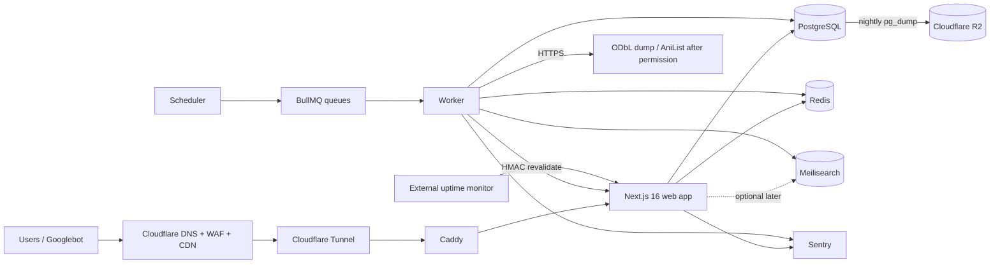

# Nimelist — Application Design Plan

**Version:** 1.0 (planning draft)
**Date:** 9 November 2026
**Status:** Ready for review; implementation not started
**Scope:** Product, information architecture, UX, data model, sync, search, auth/community, infrastructure, security/legal, roadmap

---

## 1. What Nimelist is

Nimelist is an Indonesian-language anime **information and tracking** website. It helps people answer four questions quickly:

1. Anime apa ini? (titles, synopsis, characters, staff, season)
2. Kapan tayang di Indonesia? (WIB schedule, optionally WITA/WIT)
3. Nontonnya di mana secara legal? (official Indonesian streaming platforms)
4. Bagaimana pendapat komunitas? (ratings, reviews, lists)

It is **not** a streaming site. It must never host video, embed pirate players, or link to unauthorised sources.

### Differentiators

| Differentiator | Why it matters |
|---|---|
| Indonesian UI, titles, synopses | Most databases are English-first; Indonesian search intent is underserved |
| WIB-first airing schedule | “Jadwal tayang” is a high-intent local query; JST conversion is a real pain point |
| Legal streaming availability in Indonesia | Users want to know where to watch legally, not another pirate index |
| Indonesian community | Reviews, ratings, and lists in Bahasa Indonesia |
| Later: import/sync, advanced stats, AI recommendations | Retention and premium features after the catalog is trusted |

---

## 2. Current project state (inspected 9 Nov 2026)

| Area | Current state |
|---|---|
| Framework | **Next.js 16.4.5**, App Router, React 19.3 |
| Language | TypeScript 5 strict, `@/*` path alias |
| Styling | **Tailwind CSS v4** via `@tailwindcss/turbopack`, CSS variables in `app/globals.css` |
| Lint | ESLint 9 flat config; `eslint-config-next` core-web-vitals + TypeScript |
| Package manager | **npm 11.16.0**, `package-lock.json` |
| Runtime | Node 26.4.0 |
| App code | Default `app/layout.tsx`, `app/page.tsx`, `app/globals.css` only |
| Missing | No `components/`, database, auth, tests, Docker, CI, env validation, shadcn/ui |
| Next config | `cacheComponents: true`, `partialPrefetching: true`, `experimental.agentFeedback`, Turbopack CSS rule |
| Git | One initial commit (`7ebdacf`), no remote configured |

### Next.js 16 facts the plan must respect

These differ from older App Router material and are easy to get wrong:

- `middleware.ts` is deprecated and renamed to **`proxy.ts`**.
- `params` and `searchParams` are **Promises**.
- Caching uses **`use cache`**, `cacheLife`, `cacheTag`; dynamic holes stream behind `<Suspense>`.
- On-demand invalidation uses **`revalidateTag(tag, 'max')`** or `updateTag` inside Server Actions.
- `generateSitemaps` passes `id` as a **Promise**.
- Route types such as `PageProps<"/anime/[slug]">` and `LayoutProps<"/">` are generated.
- Session reads must be behind `<Suspense>` when `cacheComponents` is enabled; use `use cache: private` for cookie-derived data that must stay browser-only.

Source: local docs in `node_modules/next/dist/docs/01-app/`.

---

## 3. Decisions taken for this round

These are the answers from the planning questions, plus the assumptions needed to make them actionable.

| Decision | Choice | Consequence |
|---|---|---|
| Data source legality | **Request written AniList permission** | No AniList ingestion until approval. Launch on ODbL seed + manual curation. |
| Team | **2–3 people** | One full-stack dev, one frontend/design, one part-time curator/editor |
| Launch shape | **4–6 week schedule MVP** | Public catalog + schedule + legal streaming + SEO. No accounts at public launch. |
| Hosting | **Laptop, 2 GB RAM / 10 GB disk, free budget** | Lean profile: no Meilisearch at launch, no self-hosted Sentry/Uptime Kuma, build in CI |
| Language | **Indonesian only** | `lang="id"`, `og:locale=id_ID`, one canonical URL set, no hreflang at launch |
| Indonesian content | **AI draft + human edit** | Original summaries, never raw machine translation of copyrighted synopses |
| Monetization | **No ads until traffic** | Affiliate links to legal platforms later; protect Core Web Vitals |
| Auth | **Better Auth 1.7.x** | Stable, Next 16 support, Prisma 7 support, email OTP + Google/Discord |
| Search | **Postgres FTS for MVP; Meilisearch target** | Fits 2 GB RAM; upgrade when moving to a VPS |
| Repo | **Single repo, npm workspaces, no Turborepo** | `apps/web`, `apps/worker`, shared packages |

### Why these choices

**Prisma 7.10.1 over Drizzle.** Prisma wins for a small team with a relational schema this size: generated client, migration workflow, relations, and Studio. Drizzle is lighter and closer to SQL, but its migration/relations tooling costs more hand-holding. Pin `prisma@7.10.1` and `@prisma/client@7.10.1`; the npm `latest` tag currently points at an 8.0 release candidate, which is not appropriate for launch.

**Postgres FTS at launch, Meilisearch later.** 41k media rows is small. Postgres `tsvector` + `pg_trgm` gives adequate search with zero extra RAM. Meilisearch adds typo tolerance and facets, but costs ~150–250 MB RAM and another service to back up. The 2 GB laptop cannot comfortably run build + Next + Postgres + Redis + Meilisearch + worker. Add Meilisearch in Phase 2/3 on a VPS.

**Better Auth over Auth.js v5.** Auth.js v5 is still `5.0.0-beta.32`; Next 16 is current. Better Auth 1.7.x explicitly supports Next 16, React 19, Prisma 7, email OTP, OAuth, admin, and rate limiting. If the team insists on Auth.js, pin the beta and run a one-day spike before committing.

**Modular monolith + worker, not microservices.** One deployable web app, one worker process, one scheduler. Clear boundaries (`web`, `worker`, `packages/db`, `packages/providers`) without network hops, distributed tracing, or service discovery. Microservices would be over-engineering for 2–3 people.

**ODbL seed + manual curation for launch.** AniList may not grant permission before Week 6. The MVP must be shippable without it. `anime-offline-database` gives a 41k-entry catalog under ODbL; current-season schedule and Indonesian streaming availability are curated manually for ~50–80 titles. This is also a genuine differentiator: accurate local data beats a bulk mirror.

**No separate worker server at launch.** The worker runs in the same Docker Compose on the laptop. Server 3 is the target profile after public validation.

---

## 4. Launch profile vs target profile

| Concern | Launch (laptop) | Target (3 servers) |
|---|---|---|
| Web | Next standalone in Docker | Server 1: Caddy + Next |
| Database | Postgres on same host | Server 2: private Postgres |
| Queue | Redis 64 MB, BullMQ | Server 2: Redis |
| Search | Postgres FTS/trigram | Server 2: Meilisearch |
| Worker | Same host, resource-limited | Server 3: BullMQ worker + scheduler |
| Monitoring | Sentry SaaS free + external uptime check | Sentry + Uptime Kuma on Server 3 |
| Backups | `pg_dump` to Cloudflare R2 free tier | Daily R2 + weekly restore test |
| Exposure | Cloudflare Tunnel (no open ports) | Cloudflare → Caddy → Next |
| Public launch suitability | Private beta only | Public launch |

**Hard truth:** a 2 GB laptop with a home ISP is acceptable for a private beta and early SEO testing. It is not a reliable public production host. The plan includes a **Phase 3 gate**: move to a ~$5/month 4 GB VPS before public launch, or accept downtime and data-loss risk. The code and Compose files stay the same; only the host changes.

---

## 5. Architecture at a glance

Core rule: **visitors only read from our database**. External APIs are touched only by the worker, and only for sources we are legally allowed to use.

---

## 6. Plan file index

| File | Contents |
|---|---|
| `00-overview.md` | This document: state, assumptions, decisions, trade-offs |
| `01-product-scope.md` | Personas, journeys, MVP vs later, MoSCoW, non-goals |
| `02-information-architecture.md` | Route map, rendering/caching, SEO plan |
| `03-ui-ux.md` | Design principles, wireframes, components, responsive/a11y |
| `04-database.md` | Schema, ERD, indexes, Indonesian content, migrations |
| `05-data-sync.md` | Jobs, schedules, rate limits, providers, error handling |
| `06-search.md` | Postgres FTS for MVP, Meilisearch target design |
| `07-auth-community.md` | Auth flows, user data, moderation, anti-spam |
| `08-architecture-infra.md` | Components, network, servers, deployment, backups |
| `09-security-legal.md` | Threat model, API terms, copyright, UU PDP/PSE |
| `10-roadmap.md` | Phased tasks, checkboxes, dependencies, estimates |
| `11-risks-open-questions.md` | Risks, mitigations, open questions, triggers |

---

## 7. Definition of “MVP done”

The 4–6 week schedule MVP is done when:

- [ ] A visitor can browse the current season and a 7-day WIB schedule without logging in.
- [ ] An anime detail page shows Indonesian title, Indonesian synopsis, genres, studio, score, and legal streaming links.
- [ ] Search by romaji, English, and Indonesian title returns useful results on mobile.
- [ ] Every indexable page has a unique Indonesian title, description, canonical URL, and JSON-LD.
- [ ] The sitemap index contains catalog, season, schedule, genre, studio, and platform pages; thin pages are `noindex`.
- [ ] The admin can edit schedule times, streaming links, and synopsis without touching SQL.
- [ ] Backups restore successfully on a clean database.
- [ ] LCP < 2.5 s and CLS < 0.1 on a mid-range Android phone over 4G.
- [ ] Privacy Policy, Terms, Community Guidelines, and Copyright/Takedown pages are live in Indonesian.
- [ ] AniList ingestion is disabled by feature flag and no AniList data is stored.

Accounts, watchlists, reviews, and premium are explicitly **after** this gate.

---

## 8. Top five risks

1. **AniList permission is not granted.** Launch depends on ODbL + manual curation. If permission is denied, the catalog remains usable but updates are labour-intensive.
2. **Image and synopsis copyright.** Posters and translated synopses are not automatically licensed by the database license. Use originals, attribution, and a takedown process; seek permission before commercial scale.
3. **2 GB laptop reliability.** Power, sleep, ISP, disk, and RAM are single points of failure. Private beta only; public launch on a VPS.
4. **Manual curation does not scale.** Current-season schedule and streaming links need a real editor with hours, not a side task.
5. **Scope creep into a tracker/community before the catalog is trusted.** The 6-week gate must stay narrow.

Full register: `11-risks-open-questions.md`.

---

## 9. Sources verified for this plan (9 Nov 2026)

| Source | What was verified | URL |
|---|---|---|
| AniList API Terms of Use | No backup/data storage, no hoarding, no competing tracker; commercial under $150/mo free, above needs licence | https://docs.anilist.co/guide/terms-of-use |
| AniList rate limiting | 90/min normal, **30/min during current degraded state**, burst limiter, no rate-limit raises currently | https://docs.anilist.co/guide/rate-limiting |
| AniList considerations | API may be suspended; 403; adult content caveats | https://docs.anilist.co/guide/considerations |
| Kitsu Terms of Use | No commercial use of Kitsu content separate from Kitsu services; API use subject to separate terms on request | https://kitsu.io/terms |
| Kitsu API docs | Public GETs, OAuth for user data, no published hard rate limit | https://kitsu.docs.apiary.io/ |
| anime-offline-database | ODbL-1.0 + DbCL; archived 4 Jul 2026; ~41,537 entries (week 27 2026); poster URLs point at MAL CDN | https://github.com/manami-project/anime-offline-database |
| ODbL 1.0 | Commercial use allowed; attribution and share-alike for derivative databases; access to derivative database required | https://opendatacommons.org/licenses/odbl/1-0/ |
| MyAnimeList API | Official beta v2 API; use for import/sync, not scraping | https://myanimelist.net/apiconfig/references/api/v2 |
| UU PDP | Law 27/2022, enacted 17 Oct 2022; rights, breach notification, DPO, cross-border transfer | https://peraturan.bpk.go.id/Details/229798 |
| PSE registration | Mandatory private-scope registration under PP 71/2019 and Permenkominfo 5/2020; takedown deadlines | https://jdih.komdigi.go.id/ |
| UU ITE | Second amendment, UU 1/2024; PSE duties, child protection, content moderation | https://jdih.kemenkoinfra.go.id/uu-12024-perubahan-kedua-uu-no-11-tahun-2008-tentang-ite |
