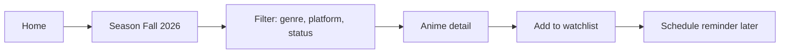
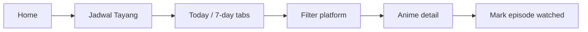
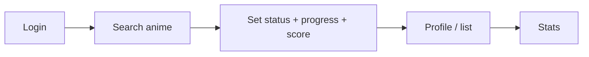
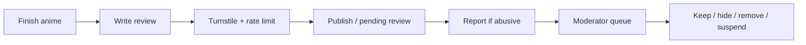

# 01 — Product Scope

## 1. Product vision

> **Nimelist adalah tempat orang Indonesia mencari tahu anime apa yang sedang tayang, kapan tayangnya dalam WIB, dan di platform legal mana bisa menontonnya — dengan sinopsis dan ulasan berbahasa Indonesia.**

Nimelist wins by being **local, accurate, and legal**, not by having the largest raw database. The catalog is the foundation; the schedule and legal streaming availability are the wedge; community and tracking are retention.

---

## 2. Target users and personas

### P1 — Rina, 19, mahasiswa, mobile-only

- Watches 3–6 seasonal anime, mostly on Bstation/Crunchyroll.
- Searches Google for “jadwal anime [season] [year]”, “[judul] episode [n] kapan tayang”, “[judul] sub indo”.
- Cares about: WIB time, whether an episode is delayed, which platform has it, spoiler-free synopsis.
- Frustration: schedule sites are in JST, cluttered with pirate ads, or outdated.
- Success: opens Nimelist on Tuesday, sees today’s schedule, taps a title, sees “Tayang 20.00 WIB di Bstation”.

### P2 — Budi, 27, pekerja, casual + backlog

- Watches 1–2 ongoing series and occasionally binge-watches old ones.
- Wants a simple watchlist and a score history; does not want a social network.
- Cares about: “Sedang Ditonton”, progress, “Rencana”, notes, no spoilers.
- Success: adds a title to his list in two taps; returns next week and continues.

### P3 — Sari, 23, community contributor

- Writes long reviews, follows seasonal discussion, wants recognition.
- Cares about: review editor, spoiler tags, profile, followers, helpful votes, moderation fairness.
- Success: publishes a review that ranks on Google and gets useful replies.

### P4 — Dimas, 21, data tinkerer / importer

- Has a MAL or AniList list with hundreds of entries.
- Wants to import once, then sync; likes stats (episodes watched, score distribution).
- This persona justifies premium later. Do not build for him at launch.

### P5 — Internal: Curator / Moderator

- Part-time Indonesian anime fan with editorial judgement.
- Needs a fast admin UI: edit schedule, streaming links, synopsis, approve/reject contributions, handle reports.
- Success: curates the current season in under 3 hours per week after setup.

---

## 3. Jobs to be done

| When | I want to… | So I can… | Product answer |
|---|---|---|---|
| A new season starts | see what is airing and where | decide what to watch | Season page + schedule |
| It is Tuesday 19.00 WIB | know what airs tonight | not miss an episode | Today schedule, countdown |
| I see a title on social media | check if it is legal to watch | avoid pirate sites | Detail page + platform badges |
| I forget an old title | search by half-remembered Indonesian/English name | find it fast | Search with synonyms/typos |
| I finish an episode | mark progress | keep my list accurate | Watchlist (Phase 2) |
| I have an opinion | rate/review without spoiling others | contribute | Ratings/reviews (Phase 4) |
| I come from MAL/AniList | bring my list | not start over | Import/sync (Phase 4) |

---

## 4. Core user journeys

### J1 — Google → detail → legal platform (primary SEO journey)

```mermaid
flowchart LR
  A[Google: "jadwal [judul] episode 5"] --> B[Detail page]
  B --> C{Streaming section}
  C -->|Legal platform available| D[Tap "Tonton di Bstation"]
  C -->|Not yet available| E[See "Belum tersedia di platform legal ID"]
  B --> F[Related anime / season]
  F --> B
```

**Requirements:** server-rendered content, Indonesian metadata, fast LCP, clear “last verified” date, no deceptive buttons.

### J2 — Seasonal planning



### J3 — Weekly schedule check



### J4 — Track and rate (Phase 2+)



### J5 — Review and moderate (Phase 4)



---

## 5. MVP definition for this round

Because the chosen launch is a **4–6 week schedule MVP**, the launch scope is deliberately narrower than the full product.

### In scope at public MVP

| Area | Included | Notes |
|---|---|---|
| Catalog | ODbL seed + curated current season | Full 41k catalog browsable; thin pages `noindex` |
| Search | Postgres FTS + trigram | Romaji, English, Indonesian, synonyms |
| Anime detail | Title, synopsis, genres, studio, score, season, episodes, status, poster | Indonesian synopsis for current/top titles |
| Schedule | 7-day WIB view, today, filters | Manual curation; WITA/WIT toggle later |
| Streaming | Legal platforms in Indonesia | Manual links, last verified, report broken link |
| Season | Current, previous, next | SEO landing pages |
| SEO | Metadata, canonical, sitemap, JSON-LD, robots | Core traffic engine |
| Admin | Curate schedule, streaming, synopsis, import | Single admin role, audited |
| Legal | Privacy, Terms, Guidelines, Copyright | Indonesian |
| Ops | Backup, restore test, uptime, Sentry | Lean profile |

### Explicitly out of scope at public MVP

- User accounts, watchlists, ratings, reviews, follows, notifications.
- MAL/AniList import or sync.
- Meilisearch (use Postgres FTS).
- Ads, premium, payments.
- Comments, forums, direct messages.
- English UI / hreflang.
- Native apps, PWA offline mode.
- Manga tracking.
- Episode-level pages with full episode metadata (only schedule rows).

### Post-MVP sequence

1. **Phase 2:** Better Auth, watchlist, progress, ratings, profile, privacy.
2. **Phase 3:** SEO hardening, monitoring, soft launch, VPS migration.
3. **Phase 4:** Reviews, follow, moderation, notifications, import/sync, Meilisearch, ads/premium.

---

## 6. Feature list and MoSCoW

### Catalog

| Feature | Priority | MVP? | Notes |
|---|---|---|---|
| Anime catalog list | Must | Yes | Paginated, filterable |
| Search (romaji/English/Indonesian/synonyms) | Must | Yes | Typo tolerant |
| Filter by genre, season, year, status, format, platform | Must | Yes | URL state, canonical rules |
| Sort by popularity, score, start date, title | Must | Yes | |
| Anime detail | Must | Yes | |
| Season pages | Must | Yes | Current + archive |
| Airing schedule (WIB) | Must | Yes | Primary differentiator |
| Legal streaming availability (ID) | Must | Yes | Manual curation |
| Characters/staff | Should | No | Phase 4; schema ready |
| Related anime | Should | No | Phase 4 |
| Episode list/metadata | Should | No | Phase 4 |
| Trailers | Could | No | Licensing/embeds |
| Tags/themes | Could | No | ODbL tags exist; curate later |

### User

| Feature | Priority | MVP? | Notes |
|---|---|---|---|
| Sign up/login (Google, Discord, email OTP) | Must (product) | No | Phase 2 |
| Watchlist statuses | Must (product) | No | Phase 2 |
| Progress tracking | Must (product) | No | Phase 2 |
| Score 1–10 | Must (product) | No | Phase 2 |
| Notes | Should | No | Phase 2 |
| Profile page | Should | No | Phase 2 |
| Privacy settings | Must | No | Phase 2 |
| Follow | Could | No | Phase 4 |
| Notifications | Could | No | Phase 4 |
| Import MAL/AniList | Could | No | Phase 4 |

### Community

| Feature | Priority | MVP? | Notes |
|---|---|---|---|
| Ratings aggregate | Should | No | Phase 2/4 |
| Written reviews | Should | No | Phase 4 |
| Spoiler tags | Must (when reviews ship) | No | |
| Report content | Must (when UGC ships) | No | |
| Moderation queue | Must (when UGC ships) | No | |
| Helpful votes | Could | No | |
| Comments | Won't (now) | No | Forum-like scope risk |

### Platform

| Feature | Priority | MVP? | Notes |
|---|---|---|---|
| SEO metadata + sitemaps | Must | Yes | |
| JSON-LD | Must | Yes | |
| Mobile-first responsive UI | Must | Yes | |
| Dark/light mode | Must | Yes | |
| Accessibility WCAG 2.2 AA | Must | Yes | |
| Admin curation | Must | Yes | |
| Backups + restore test | Must | Yes | |
| Monitoring + alerting | Must | Yes | |
| Ads | Won't (now) | No | Phase 4 |
| Premium | Won't (now) | No | Phase 4 |
| AI recommendations | Won't (now) | No | Phase 5+ |

---

## 7. Non-goals

Nimelist will **not**:

1. Host, stream, embed, or link to pirated anime, manga, or scans.
2. Scrape MyAnimeList directly. Use the official API only for user-authorised import/sync.
3. Become a general anime forum, image board, or social network.
4. Support manga tracking at launch (schema may allow it later, but the UI does not).
5. Build native iOS/Android apps in the first year.
6. Offer a public API for third parties at launch.
7. Store AniList API data without written permission.
8. Use machine translation of copyrighted synopses as published content.
9. Run microservices, Kubernetes, or a service mesh for a 2–3 person team.
10. Optimise for “nonton [judul] sub indo” piracy intent. Nimelist targets information and legal availability.

---

## 8. Success metrics

### North-star for the MVP

**Weekly organic visitors who view a schedule or detail page and click a legal streaming link.**

### Metrics

| Metric | Target (first 90 days) | Instrumentation |
|---|---|---|
| Indexed pages | 500+ quality pages, 0 thin pages indexed | Search Console |
| Organic sessions | 5,000/month by day 90 | Plausible/GA4 |
| Schedule page engagement | 40%+ scroll to “today” list | Event tracking |
| Legal streaming click-through | 8%+ of detail views | Outbound event |
| Core Web Vitals | 75th percentile: LCP < 2.5 s, INP < 200 ms, CLS < 0.1 | CrUX + RUM |
| Returning visitors | 20%+ by day 90 | Analytics |
| Curator time | < 3 h/week for current season | Manual log |
| Data freshness | Schedule updated within 24 h of a change | Admin audit |

### Anti-metrics

- Pages indexed with no Indonesian synopsis or no unique content.
- Ad impressions per session (should be zero at launch).
- Time-on-site as a vanity metric; the job is to answer a question fast.

---

## 9. Content scope and quality bar

### Catalog coverage

| Tier | Coverage | Indexable? | Content requirement |
|---|---|---|---|
| Tier A | Current season + top 500 popular | Yes | Indonesian synopsis, schedule, streaming, full metadata |
| Tier B | Top 501–2,000 | Yes, once reviewed | Indonesian synopsis, basic streaming if known |
| Tier C | Rest of ODbL (~41k) | `noindex` until reviewed | Romaji/English/native title, basic metadata |
| Tier D | Adult/explicit | `noindex`, age gate | Metadata only; no ads |

**Rule:** no programmatic page is indexed without a unique Indonesian synopsis of at least ~80 words and at least one useful data point beyond the title.

### Indonesian content workflow

1. Curator selects Tier A/B title.
2. AI drafts an **original** Indonesian summary from facts (not a translation of AniList/MAL text).
3. Human editor checks accuracy, tone, spoilers, and natural Indonesian.
4. Editor sets `synopsis_id_status = REVIEWED`, records `reviewed_by`, publishes.
5. On change, `updated_at` and `synopsis_id_updated_at` update; page revalidates.

### Editorial voice

- Casual but polite, like a knowledgeable friend.
- No clickbait, no “sub indo” claims, no pirate platform names.
- Use “platform legal” and “resmi”.
- Explain delays honestly (“Jadwal dapat berubah”; “Belum ada pengumuman resmi”).
- Spoiler-safe: premise only, no major twists.

---

## 10. Monetization principles (later)

1. **Do not monetize the answer.** Catalog, schedule, and streaming availability stay free and uncluttered.
2. **Affiliate first.** Referral links to legal platforms with clear disclosure; no pay-to-rank.
3. **Ads only after traffic and CWV are stable.** No ads above the fold on mobile, no interstitials, no auto-play video.
4. **Premium is convenience, not access.** Ad-free, advanced stats, import/sync, AI recommendations. Never paywall the catalog.
5. **No pirate-adjacent advertisers.** Brand safety matters more than short-term CPM.

---

## 11. Assumptions to validate

| Assumption | How to validate | Deadline |
|---|---|---|
| AniList will grant written permission for a complementary Indonesian info/tracker service | Send request in Phase 0; document response | Week 1–2 |
| ODbL seed is legally usable with attribution/share-alike | Legal review; publish attribution and derived DB offer | Week 1 |
| 50–80 current-season titles can be curated in < 3 h/week | Time the first two weeks | Week 3 |
| Users will click legal streaming links | Track outbound clicks from day one | Week 6 |
| Laptop can serve beta traffic | Load test + uptime monitor | Week 4 |
| 4–6 weeks is enough for the narrow MVP | Track Phase 1 exit criteria weekly | Week 4 |
