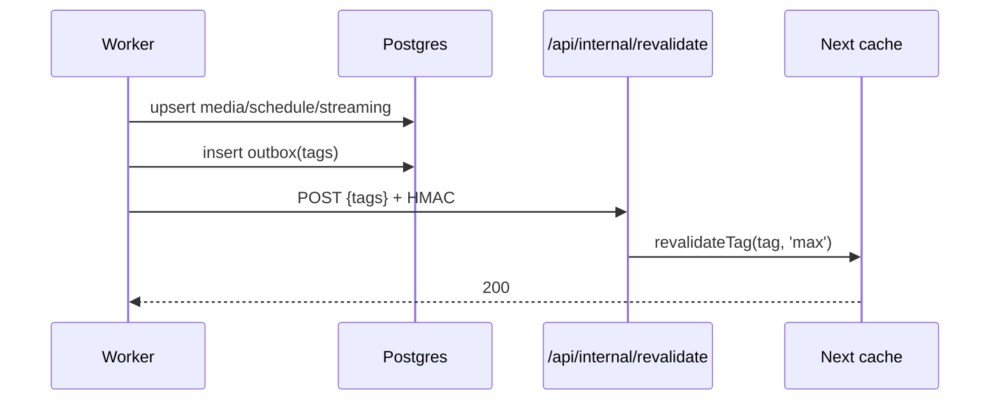

# 02 — Information Architecture, Routes, Rendering, and SEO

## 1. Principles

1. **Every indexable page answers one Indonesian search intent.** No orphan pages, no thin programmatic pages.
2. **Server-render the content that Google needs.** Client components only for interaction.
3. **Cache the catalog, stream the person.** Public catalog pages are shared cache; user-specific UI is a dynamic hole.
4. **URLs are permanent.** Slugs are generated once; changes produce 301s, never broken links.
5. **One canonical URL per intent.** Filters, sorts, and tracking parameters do not create duplicate indexable pages.

---

## 2. Route map

Base URL: `https://nimelist.id` (placeholder; confirm domain).

### Public, indexable

| Route | Purpose | Auth | Data needed | Rendering / caching | Indexable |
|---|---|---|---|---|---|
| `/` | Home: current season, today’s schedule, popular, platform shortcuts | No | Season, schedule today, popular media, platforms | Static shell + `use cache`; `cacheLife('minutes')`; tags `home`, `schedule:today`, `season:current` | Yes |
| `/anime` | Catalog browse | No | Media list, genres, filters, total count | Static shell + dynamic `searchParams`; base page cached; filters client-driven | Yes (base only) |
| `/anime/[slug]` | Anime detail | No | Media, genres, studios, schedule, streaming, related | `use cache`; `cacheLife('days')`; tag `media:{id}`; prerender top 500 + current season | Yes |
| `/anime/[slug]/episode/[episode]` | Episode detail (later) | No | Episode, schedule, streaming | `use cache`; `cacheLife('days')`; tag `media:{id}` | Yes, when episode content exists |
| `/season/[seasonYear]` | Season page, e.g. `/season/fall-2026` | No | Season media, counts, platforms | `use cache`; current `cacheLife('hours')`, past `days`; tag `season:{seasonYear}` | Yes |
| `/jadwal-tayang` | 7-day schedule, default today WIB | No | Schedule rows, media, platforms | `use cache`; `cacheLife('minutes')`; tag `schedule` | Yes |
| `/jadwal-tayang/[date]` | Date-specific schedule, `YYYY-MM-DD` | No | Schedule rows for date | Past: `cacheLife('max')`; today/future: `minutes`; tag `schedule:{date}` | Yes |
| `/genre/[slug]` | Genre landing | No | Media by genre, counts | `use cache`; `cacheLife('days')`; tag `genre:{slug}` | Yes |
| `/studio/[slug]` | Studio landing | No | Media by studio | `use cache`; `cacheLife('days')`; tag `studio:{slug}` | Yes |
| `/platform/[slug]` | Legal platform landing | No | Platform, media available | `use cache`; `cacheLife('days')`; tag `platform:{slug}` | Yes |
| `/character/[slug]` | Character page (later) | No | Character, media, VA | `use cache`; `cacheLife('days')` | Yes, when populated |
| `/staff/[slug]` | Staff/person page (later) | No | Person, credits | `use cache`; `cacheLife('days')` | Yes, when populated |
| `/reviews` | Review index (later) | No | Published reviews | `use cache`; `cacheLife('hours')` | Yes |
| `/review/[id]-[slug]` | Review detail (later) | No | Review, media, author | `use cache`; `cacheLife('hours')`; tag `review:{id}` | Yes |
| `/about` | About, editorial policy, team | No | Static | Static | Yes |
| `/privacy` | Privacy Policy (UU PDP) | No | Static | Static | Yes |
| `/terms` | Terms of Service | No | Static | Static | Yes |
| `/guidelines` | Community guidelines | No | Static | Static | Yes |
| `/copyright` | Copyright/takedown policy | No | Static | Static | Yes |
| `/contact` | Contact | No | Static + form | Static shell + Server Action | Yes |

### Public, not indexable

| Route | Purpose | Auth | Rendering | Robots |
|---|---|---|---|---|
| `/search?q=` | Search results | No | Dynamic; results cached 60 s in Redis | `noindex,follow` |
| `/anime?genre=&season=&sort=&page=` | Filtered catalog | No | Dynamic | `noindex,follow` except curated landing pages |
| `/login` | Login | No | Static shell + client form | `noindex` |
| `/register` | Register | No | Static shell + client form | `noindex` |
| `/verify` | Email verification | No | Dynamic | `noindex` |
| `/forgot-password` | Password reset (if enabled) | No | Static shell | `noindex` |
| `/settings/*` | Account settings | Yes | Dynamic; session in Suspense | `noindex` |
| `/user/[username]` | Public profile (later) | Optional | Cached if public; dynamic if private | Indexable only if public opt-in |
| `/user/[username]/list` | Public list (later) | Optional | Dynamic/cached per privacy | Usually `noindex` |
| `/import` | MAL/AniList import (later) | Yes | Dynamic | `noindex` |
| `/premium` | Premium landing (later) | No | Static | Yes, when real |
| `/offline` | Offline fallback (PWA later) | No | Static | `noindex` |

### Admin, never indexable

| Route | Purpose |
|---|---|
| `/admin` | Dashboard: sync status, curation queue, reports |
| `/admin/media` | Media list/search/edit |
| `/admin/media/[id]` | Edit media, titles, synopsis, genres, studios |
| `/admin/schedule` | Curate airing schedule, bulk generate, verify |
| `/admin/streaming` | Curate platform links, last verified, broken reports |
| `/admin/synopsis` | Indonesian synopsis review queue |
| `/admin/reports` | Moderation reports (later) |
| `/admin/sync` | Job runs, retries, logs |
| `/admin/audit` | Audit log |
| `/admin/users` | User administration (later) |

Admin is protected by role `ADMIN` and `noindex, nofollow`. Prefer a separate `admin.` subdomain later; not needed at launch.

### API routes

| Route | Purpose | Auth |
|---|---|---|
| `/api/auth/[...all]` | Better Auth handler | Public |
| `/api/health` | Liveness/readiness for Caddy/Docker | Internal |
| `/api/internal/revalidate` | Worker → Next on-demand revalidation | HMAC + IP allowlist |
| `/api/search/suggest` | Typeahead suggestions | Public, rate-limited |
| `/api/report` | Report broken link/content | Public, Turnstile + rate limit |
| `/api/og/[slug]` | Dynamic OG image (optional) | Public, cached |

### Metadata routes

| Route | Purpose |
|---|---|
| `/sitemap.xml` | Sitemap index |
| `/sitemaps/static.xml` | Static pages |
| `/sitemaps/media-[n].xml` | Media chunks (10k URLs) |
| `/sitemaps/seasons.xml` | Season pages |
| `/sitemaps/genres.xml` | Genre pages |
| `/sitemaps/studios.xml` | Studio pages |
| `/sitemaps/platforms.xml` | Platform pages |
| `/sitemaps/reviews-[n].xml` | Reviews (later) |
| `/robots.txt` | Crawl rules + sitemap index |
| `/manifest.webmanifest` | PWA metadata (later) |
| `/opensearch.xml` | Browser search (optional) |

---

## 3. Route tree

```text
app/
├── layout.tsx
├── page.tsx                         /
├── anime/
│   ├── page.tsx                     /anime
│   └── [slug]/
│       ├── page.tsx                 /anime/[slug]
│       └── episode/[episode]/page.tsx
├── season/[seasonYear]/page.tsx     /season/fall-2026
├── jadwal-tayang/
│   ├── page.tsx                     /jadwal-tayang
│   └── [date]/page.tsx              /jadwal-tayang/2026-11-09
├── genre/[slug]/page.tsx
├── studio/[slug]/page.tsx
├── platform/[slug]/page.tsx
├── character/[slug]/page.tsx        (later)
├── staff/[slug]/page.tsx            (later)
├── reviews/page.tsx                 (later)
├── review/[id]-[slug]/page.tsx      (later)
├── search/page.tsx
├── (auth)/
│   ├── login/page.tsx
│   ├── register/page.tsx
│   └── verify/page.tsx
├── settings/
│   ├── profile/page.tsx
│   ├── account/page.tsx
│   └── privacy/page.tsx
├── user/[username]/page.tsx         (later)
├── admin/
│   ├── layout.tsx
│   ├── page.tsx
│   ├── media/page.tsx
│   ├── media/[id]/page.tsx
│   ├── schedule/page.tsx
│   ├── streaming/page.tsx
│   ├── synopsis/page.tsx
│   └── sync/page.tsx
├── (legal)/
│   ├── about/page.tsx
│   ├── privacy/page.tsx
│   ├── terms/page.tsx
│   ├── guidelines/page.tsx
│   ├── copyright/page.tsx
│   └── contact/page.tsx
├── sitemap.xml/route.ts             (sitemap index)
├── sitemaps/[type]/[page]/route.ts  (child sitemaps)
├── robots.ts
├── not-found.tsx
├── error.tsx
└── globals.css
```

**Note:** Next.js metadata `sitemap.ts` cannot emit a sitemap index with child sitemaps. Use a custom `app/sitemap.xml/route.ts` returning `<sitemapindex>` and route handlers for each child. Cache them with `use cache` / `cacheLife('days')` and revalidate on content changes.

---

## 4. Rendering and caching strategy (Next.js 16)

### 4.1 Model

- `cacheComponents: true` and `partialPrefetching: true` are already enabled.
- **Static shell** renders instantly. Uncached data streams behind `<Suspense>`.
- **`use cache`** wraps data functions and shared UI. Always pair with `cacheLife`.
- **`cacheTag`** enables on-demand invalidation.
- **`revalidateTag(tag, 'max')`** from a Route Handler after sync; stale-while-revalidate.
- **`updateTag`** only in Server Actions for read-your-own-writes (watchlist changes later).
- **`use cache: private`** for cookie-derived data that must stay browser-only (session profile).
- **Do not cache session reads on the server.** Extract `userId` and pass it into a cached function if needed.
- Reading `cookies()` outside `<Suspense>` is a build error under Cache Components.

### 4.2 Cache profiles

| Profile | stale | revalidate | expire | Use |
|---|---|---|---|---|
| `minutes` | 5 m | 1 m | 1 h | Home, today schedule, search counts |
| `hours` | 5 m | 1 h | 1 d | Current season, review index |
| `days` | 5 m | 1 d | 1 w | Detail pages, genre/studio/platform |
| `weeks` | 5 m | 1 w | 30 d | Past seasons, static editorial |
| `max` | 5 m | 30 d | 1 y | Past schedule dates, legal pages |

### 4.3 Route-level cache matrix

| Page | `use cache` scope | `cacheLife` | Tags | Invalidated by |
|---|---|---|---|---|
| Home | Data functions | `minutes` | `home`, `schedule:today`, `season:current` | Schedule sync, media update, season rollover |
| Catalog base | Media query | `hours` | `catalog` | Media publish/unpublish |
| Detail | Media aggregate | `days` | `media:{id}`, `genre:{slug}`, `studio:{slug}`, `platform:{slug}` | Media update, streaming update, schedule update |
| Season current | Season query | `hours` | `season:{seasonYear}`, `catalog` | Media update, schedule update |
| Season past | Season query | `weeks` | `season:{seasonYear}` | Manual refresh only |
| Schedule today/future | Schedule query | `minutes` | `schedule`, `schedule:{date}` | Schedule sync |
| Schedule past | Schedule query | `max` | `schedule:{date}` | Manual refresh only |
| Genre | Genre query | `days` | `genre:{slug}` | Media-genre change |
| Studio | Studio query | `days` | `studio:{slug}` | Media-studio change |
| Platform | Platform query | `days` | `platform:{slug}` | Streaming link change |
| Review | Review query | `hours` | `review:{id}`, `media:{id}` | Publish/edit/remove |
| Profile public | Profile query | `hours` | `user:{id}` | Profile/list change |
| Sitemaps | URL queries | `days` | `sitemap` | Media/season/taxonomy change |

### 4.4 Pre-rendering

- `generateStaticParams` for:
  - Top 500 media by popularity.
  - All current-season media.
  - All season pages from 2000 to next year.
  - All genres, studios with ≥ 3 media, active platforms.
- Unknown slugs: App Shell + background upgrade (Partial Prefetching), then cached.
- Do **not** prerender all 41k media at build; it would blow the 2 GB laptop and CI time.
- Use `generateStaticParams` with a DB query at build. Build runs in GitHub Actions, not on the laptop.

### 4.5 Dynamic holes

| Hole | Why dynamic | Boundary |
|---|---|---|
| User menu / session | cookies | `<Suspense>` in header |
| Watchlist status on detail | session | `<Suspense>` around `AddToList` (Phase 2) |
| Review composer | session | `<Suspense>` (Phase 4) |
| “Continue watching” | session | `<Suspense>` (Phase 2) |
| Live countdown | client time | Client component, hydrate-safe |
| Current time / timezone toggle | client | Client component after hydration |

### 4.6 On-demand revalidation flow



- Worker batches tags and coalesces for 30 seconds.
- HMAC secret + `X-Internal-Token`; route rejects non-private IPs.
- Idempotent; safe to retry.
- If the app is down, outbox retries with backoff; sitemaps and pages revalidate on next request anyway.

---

## 5. SEO plan

### 5.1 Slug strategy

| Entity | Pattern | Example | Rules |
|---|---|---|---|
| Media | `/anime/{slug}` | `/anime/sousou-no-frieren` | Kebab-case from `title_romaji`; ASCII; max 80 chars; generated once; immutable |
| Season | `/season/{season}-{year}` | `/season/fall-2026` | Lowercase English season + 4-digit year |
| Schedule date | `/jadwal-tayang/{yyyy-mm-dd}` | `/jadwal-tayang/2026-11-09` | ISO date, Asia/Jakarta |
| Genre | `/genre/{slug}` | `/genre/isekai` | Kebab-case |
| Studio | `/studio/{slug}` | `/studio/mappa` | Kebab-case |
| Platform | `/platform/{slug}` | `/platform/bstation` | Kebab-case |
| Review | `/review/{id}-{slug}` | `/review/123-frieren-review` | ID prevents collisions; slug for keywords |
| User | `/user/{username}` | `/user/sari` | Lowercase, unique |

**Collision handling:** if a slug exists, append `-2`, `-3`, or the season year. Never use the internal numeric ID in the public slug unless necessary.

**Slug changes:** keep `media_slug_history`. On a 404, look up the old slug, `permanentRedirect()` to the new one (301). Never reuse a slug for a different media.

**Indonesian titles:** the H1 uses `title_id` when reviewed; the URL uses romaji for stability. Show all alternate titles in the page body.

### 5.2 Metadata templates

| Page | `title` | `description` |
|---|---|---|
| Home | `Nimelist — Jadwal Anime, Sinopsis, dan Platform Legal Indonesia` | `Cari jadwal tayang anime dalam WIB, baca sinopsis bahasa Indonesia, dan temukan platform legal untuk menonton.` |
| Anime | `{title_id or title_romaji} — Sinopsis, Jadwal, Platform Legal` | `Sinopsis {title}, jadwal tayang WIB, dan daftar platform legal di Indonesia. Diperbarui {date}.` |
| Season | `Anime {Season} {Year} — Jadwal Tayang WIB & Platform Legal` | `Daftar anime {Season} {Year} lengkap dengan jadwal WIB, genre, dan platform legal di Indonesia.` |
| Schedule today | `Jadwal Anime Hari Ini, {date} — WIB` | `Jadwal tayang anime hari ini dalam WIB, lengkap dengan platform legal dan jam tayang.` |
| Genre | `Anime {Genre} Terbaik — Sinopsis & Platform Legal` | `Rekomendasi anime genre {genre} dengan sinopsis Indonesia dan info platform legal.` |
| Platform | `Anime di {Platform} — Daftar & Jadwal` | `Daftar anime yang tersedia di {Platform} Indonesia, lengkap dengan jadwal dan sinopsis.` |
| Review | `Review {title} — {review_title}` | `{excerpt}` |

Implementation: `generateMetadata` in each page, `metadataBase: new URL(process.env.NEXT_PUBLIC_SITE_URL)`, title template `%s | Nimelist` in root layout. Descriptions 140–160 characters. No keyword stuffing.

### 5.3 Canonical rules

- One host: `https://nimelist.id` (apex). `www` → apex 301.
- HTTPS only; HSTS.
- No trailing slash (except root). Caddy/Next redirect.
- Lowercase paths.
- Strip `utm_*`, `fbclid`, `gclid`, `ref` from canonical.
- Detail: canonical to the current slug.
- Pagination: `?page=n` self-canonical; do not canonicalise page 2 to page 1.
- Filtered catalog: `noindex,follow`; canonical to `/anime` is acceptable only for the unfiltered base.
- Search: `noindex,follow`.
- Duplicate season URLs: only `/season/fall-2026`; redirect `/season/2026/fall`, `/anime/season/fall-2026`.
- Removed media: 410 with a helpful page; if merged, 301 to the surviving media.

### 5.4 Sitemaps

Custom sitemap index, not the default single `sitemap.ts`:

```xml
<sitemapindex xmlns="http://www.sitemaps.org/schemas/sitemap/0.9">
  <sitemap><loc>https://nimelist.id/sitemaps/static.xml</loc></sitemap>
  <sitemap><loc>https://nimelist.id/sitemaps/media-0.xml</loc></sitemap>
  <sitemap><loc>https://nimelist.id/sitemaps/seasons.xml</loc></sitemap>
  <sitemap><loc>https://nimelist.id/sitemaps/genres.xml</loc></sitemap>
  <sitemap><loc>https://nimelist.id/sitemaps/studios.xml</loc></sitemap>
  <sitemap><loc>https://nimelist.id/sitemaps/platforms.xml</loc></sitemap>
</sitemapindex>
```

| Sitemap | Contents | Limit | `lastmod` |
|---|---|---|---|
| `static.xml` | Home, about, legal, contact | 20 | Deploy date |
| `media-[n].xml` | Indexable media only (`synopsis_id_status = REVIEWED`) | 10,000 | `media.updated_at` |
| `seasons.xml` | Season pages 2000–next year | 100 | Season update |
| `genres.xml` | Genres with ≥ 1 published media | 100 | Genre update |
| `studios.xml` | Studios with ≥ 3 published media | 5,000 | Studio update |
| `platforms.xml` | Active legal platforms | 50 | Platform update |
| `reviews-[n].xml` | Published reviews (later) | 10,000 | `review.updated_at` |

- Include `<image:image>` for posters only if we have the right to display them; otherwise omit.
- `robots.ts` points to `https://nimelist.id/sitemap.xml`.
- Submit to Google Search Console and Bing Webmaster Tools.
- Do not use the deprecated sitemap ping endpoint.
- Revalidate sitemap caches when media is published/unpublished.

### 5.5 JSON-LD

| Page | Types | Notes |
|---|---|---|
| Sitewide | `WebSite`, `Organization` | `SearchAction` only if `/search?q={query}` works |
| Anime detail | `TVSeries` or `Movie` | `name`, `alternateName`, `description`, `image`, `genre`, `numberOfEpisodes`, `datePublished`, `inLanguage`, `countryOfOrigin`, `productionCompany` |
| Anime detail with our ratings | `aggregateRating` | Only after real user ratings exist; never fabricate |
| Episode | `TVEpisode` | Later, when episode pages exist |
| Season/genre/platform | `ItemList` | `itemListElement` with `url` and `name` |
| All content pages | `BreadcrumbList` | Mirrors visible breadcrumbs |
| Review | `Review` + `Rating` | Later; Google may not show self-serving review rich results |
| FAQ | `FAQPage` | Only for genuine FAQ content, not keyword spam |

Implementation: native `<script type="application/ld+json">`, `JSON.stringify(...).replace(/</g, '\\u003c')`. Use `schema-dts` for types. Validate with Rich Results Test and Schema Markup Validator.

### 5.6 Open Graph and social

- `og:title`, `og:description`, `og:image` (1200×630), `og:type` (`website` or `article`), `og:locale=id_ID`.
- Twitter card `summary_large_image`.
- Dynamic OG images per anime/season using `opengraph-image.tsx`; cache for days.
- Fallback static OG image with logo and tagline.
- Do not use copyrighted poster as the only OG image without permission; use a branded composition with poster thumbnail if licensed.

### 5.7 Indonesian SEO specifics

**Keyword clusters**

| Cluster | Example queries | Landing page |
|---|---|---|
| Schedule | `jadwal anime hari ini`, `jadwal tayang anime fall 2026`, `jam tayang anime WIB` | `/jadwal-tayang`, `/season/fall-2026` |
| Title intent | `[judul] sinopsis`, `[judul] episode 5 kapan tayang`, `[judul] di platform legal` | `/anime/[slug]` |
| Genre | `anime isekai terbaik`, `anime romance 2026` | `/genre/isekai` |
| Platform | `anime di bstation`, `anime netflix indonesia` | `/platform/bstation` |
| Legal | `nonton anime legal di indonesia`, `platform resmi anime` | `/platform` hub, `/about` |

**Do not chase:** “nonton [judul] sub indo”, “download [judul]”, “batch [judul]”. These attract piracy intent and are not defensible.

**On-page**

- `lang="id"`, `og:locale="id_ID"`.
- Natural Indonesian, not translated English sentence structure.
- Dates/times in WIB with `Intl.DateTimeFormat('id-ID', { timeZone: 'Asia/Jakarta' })`.
- Use “tayang”, “platform legal”, “sinopsis”, “jadwal”, “episode”, “musim”.
- Include the Japanese/romaji title in the body for users who search that way.
- Show “Terakhir diperbarui” and “Sumber” for schedule/streaming claims.

**E-E-A-T**

- About page with real editorial policy and curator bios.
- “Last updated” and “Sumber” on data-heavy pages.
- Corrections/takedown policy.
- Contact page with a real response channel.
- No anonymous AI content without review; byline “Ditinjau oleh [editor]” when appropriate.

**Internal linking**

```text
Home
 ├─ Current season
 │   ├─ Anime detail
 │   │   ├─ Genre
 │   │   ├─ Studio
 │   │   ├─ Platform
 │   │   └─ Related anime
 │   └─ Schedule day
 ├─ Popular
 └─ Platforms
```

- Breadcrumbs on every content page.
- “Musim sebelumnya / berikutnya” on season pages.
- “Anime lain di studio ini”, “Genre terkait”, “Tersedia juga di”.
- Avoid link farms; 10–30 contextual links per page is plenty.

### 5.8 Technical SEO checklist

- [ ] `metadataBase` set from env.
- [ ] Unique `<title>` and meta description per indexable page.
- [ ] Canonical on every page.
- [ ] `robots.ts` with sitemap index.
- [ ] Sitemap split; `lastmod` accurate.
- [ ] JSON-LD validated.
- [ ] `noindex` on admin, auth, settings, search, filtered, thin, adult.
- [ ] 301 slug history; 410 removed media.
- [ ] `hreflang` not used until English exists.
- [ ] Server-rendered H1 and body content.
- [ ] Image `alt`, dimensions, `sizes`, LCP priority.
- [ ] No client-only catalog.
- [ ] Core Web Vitals budget in CI (Lighthouse).
- [ ] Search Console + Bing verified.
- [ ] Analytics respects consent.
- [ ] XML sitemap under 50 MB / 50k URLs per file.
- [ ] No duplicate content from pagination/filters.
- [ ] Open Graph preview tested.

---

## 6. Redirect and error policy

| Situation | Response |
|---|---|
| Old media slug | 301 to current slug |
| Merged duplicate media | 301 to canonical media |
| Removed media with no replacement | 410 with explanation + search |
| Invalid season | 404 |
| Invalid date | 404 |
| Out-of-range page | 404, not empty 200 |
| `www` or `http` | 301 to canonical |
| Trailing slash | 301 to no-slash |
| Uppercase path | 301 to lowercase |
| Adult media | 200 but `noindex`, age gate |
| Thin media | 200 but `noindex` until reviewed |

`not-found.tsx` should offer search, current season, and schedule links. `error.tsx` should offer retry and a link home, and report to Sentry.

---

## 7. Analytics and measurement

- Privacy-friendly analytics (Plausible or Umami) preferred over GA4 at launch; if GA4, use Consent Mode v2.
- Events:
  - `search_submit` (query length bucket, not raw PII)
  - `filter_apply` (facet)
  - `streaming_click` (platform, media id)
  - `schedule_date_change`
  - `outbound_legal`
  - `report_broken_link`
- Search Console for queries, impressions, CTR, indexing.
- RUM for Core Web Vitals (`useReportWebVitals` or a small beacon).
- No personal data in analytics; no raw search queries tied to user IDs.
