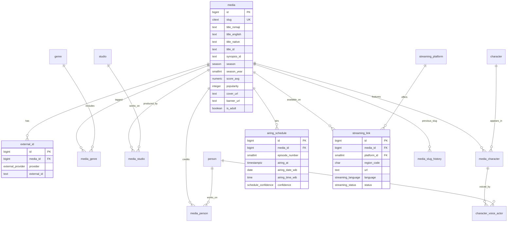
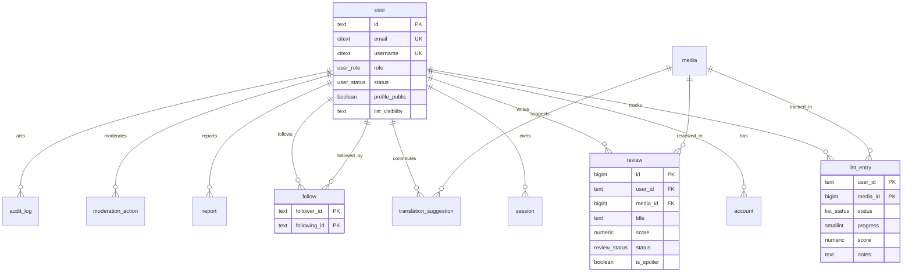
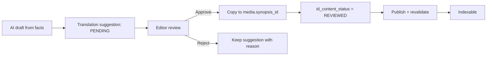

# 04 — Data Model

## 1. Database choice and conventions

- **PostgreSQL 17+** (18 if the hosting image is stable). Use `citext`, `pg_trgm`, `unaccent`, and built-in full-text search.
- **Prisma 7.10.1** pinned for schema, migrations, and typed client. Do not use the npm `latest` tag: it currently points at an 8.0 release candidate.
- Table names: `snake_case`, singular (`media`, not `medias`). Prisma models `PascalCase` with `@@map`.
- Primary keys:
  - Catalog: `bigint generated always as identity`.
  - Auth/user: `text` IDs (Better Auth generates them).
- Timestamps: `timestamptz`, UTC in the database. WIB is a presentation concern; schedule rows also store denormalised WIB date/time for fast queries.
- Soft delete: `deleted_at` on `media`, `user`, `review`. Hard delete is a scheduled job after a retention window.
- All foreign keys have an explicit `ON DELETE` policy.
- All money/score values use `numeric`, never floats.
- No ENUM changes without a migration; prefer `text` + `CHECK` for values likely to change (e.g., platform names).

---

## 2. Enum types

| Enum | Values |
|---|---|
| `media_format` | `TV`, `TV_SHORT`, `MOVIE`, `SPECIAL`, `OVA`, `ONA`, `MUSIC`, `UNKNOWN` |
| `media_status` | `FINISHED`, `RELEASING`, `NOT_YET_RELEASED`, `CANCELLED`, `HIATUS`, `UNKNOWN` |
| `season` | `WINTER`, `SPRING`, `SUMMER`, `FALL`, `UNDEFINED` |
| `content_status` | `MISSING`, `DRAFT`, `REVIEWED`, `PUBLISHED`, `REJECTED` |
| `external_provider` | `ANILIST`, `KITSU`, `MAL`, `ANIDB`, `ANIME_OFFLINE_DATABASE`, `TMDB`, `MANUAL` |
| `schedule_confidence` | `CONFIRMED`, `ESTIMATED`, `DELAYED`, `CANCELLED` |
| `schedule_source` | `OFFICIAL_SITE`, `PLATFORM`, `MANUAL`, `ANILIST`, `KITSU` |
| `streaming_language` | `SUB`, `DUB`, `SUB_DUB`, `RAW`, `UNKNOWN` |
| `streaming_access` | `FREE`, `SUBSCRIPTION`, `RENTAL`, `PURCHASE`, `UNKNOWN` |
| `streaming_status` | `ACTIVE`, `STALE`, `BROKEN`, `REMOVED` |
| `list_status` | `WATCHING`, `COMPLETED`, `PLANNED`, `DROPPED`, `ON_HOLD` |
| `review_status` | `DRAFT`, `PENDING`, `PUBLISHED`, `HIDDEN`, `REMOVED` |
| `report_status` | `OPEN`, `REVIEWING`, `RESOLVED`, `DISMISSED` |
| `user_role` | `USER`, `MODERATOR`, `ADMIN` |
| `user_status` | `ACTIVE`, `SUSPENDED`, `DELETED` |
| `translation_field` | `TITLE_ID`, `SYNOPSIS_ID`, `ALIAS` |
| `translation_status` | `PENDING`, `APPROVED`, `REJECTED`, `MERGED` |
| `sync_status` | `RUNNING`, `SUCCESS`, `PARTIAL`, `FAILED` |
| `outbox_status` | `PENDING`, `PROCESSING`, `DONE`, `FAILED` |
| `character_role` | `MAIN`, `SUPPORTING`, `BACKGROUND` |

---

## 3. Catalog schema

### 3.1 `media`

| Column | Type | Constraints | Notes |
|---|---|---|---|
| `id` | `bigint` | PK, identity | Internal only |
| `slug` | `citext` | NOT NULL, UNIQUE | Kebab-case; immutable; generated once |
| `title_romaji` | `text` | NOT NULL | Primary display/search title |
| `title_english` | `text` | | |
| `title_native` | `text` | | Japanese |
| `title_id` | `text` | | Indonesian title, curated |
| `synonyms` | `text[]` | NOT NULL DEFAULT `{}` | Alternative titles/spellings |
| `synopsis` | `text` | | Source-language synopsis (if licensed) |
| `synopsis_id` | `text` | | Original Indonesian summary |
| `format` | `media_format` | NOT NULL DEFAULT `UNKNOWN` | TV/movie/OVA |
| `status` | `media_status` | NOT NULL DEFAULT `UNKNOWN` | |
| `season` | `season` | | |
| `season_year` | `smallint` | | CHECK 1900–2100 |
| `episodes` | `smallint` | CHECK ≥ 0 | Nullable for unknown |
| `duration_minutes` | `smallint` | CHECK > 0 | Per episode |
| `start_date` | `date` | | |
| `end_date` | `date` | | |
| `broadcast_weekday` | `smallint` | CHECK 1–7 | ISO: 1=Monday, 7=Sunday |
| `broadcast_time_jst` | `time` | | Recurring schedule |
| `country_of_origin` | `char(2)` | | ISO 3166-1 |
| `source_type` | `text` | | Manga, light novel, original |
| `is_adult` | `boolean` | NOT NULL DEFAULT false | `noindex`, age gate |
| `cover_url` | `text` | | |
| `banner_url` | `text` | | |
| `cover_color` | `char(7)` | | Hex placeholder colour |
| `score_avg` | `numeric(4,2)` | CHECK 0–10 | Nimelist aggregate, not provider score |
| `score_count` | `integer` | NOT NULL DEFAULT 0 | |
| `popularity` | `integer` | NOT NULL DEFAULT 0 | Local popularity rank/score |
| `favourites` | `integer` | NOT NULL DEFAULT 0 | |
| `trending` | `integer` | NOT NULL DEFAULT 0 | |
| `id_content_status` | `content_status` | NOT NULL DEFAULT `MISSING` | `synopsis_id`/`title_id` readiness |
| `synopsis_id_status` | `content_status` | NOT NULL DEFAULT `MISSING` | |
| `curated_fields` | `text[]` | NOT NULL DEFAULT `{}` | Provider sync must not overwrite |
| `field_provenance` | `jsonb` | NOT NULL DEFAULT `{}` | `{ "title_romaji": "odbl", ... }` |
| `search_text` | `text` | | Denormalised search corpus |
| `search_vector` | `tsvector` | GENERATED ALWAYS AS `to_tsvector('simple', coalesce(search_text,''))` STORED | GIN indexed |
| `data_quality` | `smallint` | NOT NULL DEFAULT 0 | 0–100 completeness score |
| `created_at` | `timestamptz` | NOT NULL DEFAULT now() | |
| `updated_at` | `timestamptz` | NOT NULL DEFAULT now() | |
| `last_synced_at` | `timestamptz` | | |
| `deleted_at` | `timestamptz` | | Soft delete |

**Checks**

- `slug ~ '^[a-z0-9]+(?:-[a-z0-9]+)*$'`
- `season IS NULL OR season_year IS NOT NULL`
- `score_avg BETWEEN 0 AND 10`
- `episodes IS NULL OR episodes >= 0`
- `duration_minutes IS NULL OR duration_minutes > 0`
- `broadcast_weekday IS NULL OR broadcast_weekday BETWEEN 1 AND 7`
- `title_romaji <> ''`

**Why `search_text` is denormalised:** with 41k rows, a generated `tsvector` over titles + synonyms + genre/studio names is fast and avoids joins at query time. Rebuild `search_text` when media, genres, or studios change. If Meilisearch is added later, it becomes the primary search and Postgres remains a fallback.

### 3.2 `media_slug_history`

| Column | Type | Constraints |
|---|---|---|
| `id` | `bigint` | PK |
| `media_id` | `bigint` | FK → `media.id` ON DELETE CASCADE |
| `slug` | `citext` | NOT NULL, UNIQUE |
| `created_at` | `timestamptz` | NOT NULL DEFAULT now() |

On 404, look up the slug here and `permanentRedirect()` to the current slug. Never reuse a historical slug for another media.

### 3.3 `external_id`

| Column | Type | Constraints |
|---|---|---|
| `id` | `bigint` | PK |
| `media_id` | `bigint` | FK → `media.id` ON DELETE CASCADE |
| `provider` | `external_provider` | NOT NULL |
| `external_id` | `text` | NOT NULL |
| `url` | `text` | |
| `is_primary` | `boolean` | NOT NULL DEFAULT false |
| `created_at` | `timestamptz` | NOT NULL DEFAULT now() |

**Critical constraint:** `UNIQUE (provider, external_id)`. This is the idempotency key for every provider upsert. Index `(media_id, provider)`.

### 3.4 `genre` and `media_genre`

`genre`

| Column | Type | Constraints |
|---|---|---|
| `id` | `smallint` | PK |
| `slug` | `citext` | NOT NULL, UNIQUE |
| `name` | `text` | NOT NULL |
| `name_id` | `text` | |
| `description_id` | `text` | |
| `created_at` | `timestamptz` | NOT NULL DEFAULT now() |

`media_genre`

| Column | Type | Constraints |
|---|---|---|
| `media_id` | `bigint` | FK → `media.id` ON DELETE CASCADE |
| `genre_id` | `smallint` | FK → `genre.id` ON DELETE CASCADE |
| PK | `(media_id, genre_id)` | |
| Index | `(genre_id, media_id)` | |

### 3.5 `studio` and `media_studio`

`studio`

| Column | Type | Constraints |
|---|---|---|
| `id` | `bigint` | PK |
| `slug` | `citext` | NOT NULL, UNIQUE |
| `name` | `text` | NOT NULL |
| `name_native` | `text` | |
| `website_url` | `text` | |
| `created_at` | `timestamptz` | NOT NULL DEFAULT now() |

`media_studio`

| Column | Type | Constraints |
|---|---|---|
| `media_id` | `bigint` | FK → `media.id` ON DELETE CASCADE |
| `studio_id` | `bigint` | FK → `studio.id` ON DELETE CASCADE |
| `is_animation_studio` | `boolean` | NOT NULL DEFAULT true |
| PK | `(media_id, studio_id)` | |
| Index | `(studio_id, media_id)` | |

### 3.6 People, staff, characters, voice actors

`person` (staff and voice actors)

| Column | Type | Constraints |
|---|---|---|
| `id` | `bigint` | PK |
| `slug` | `citext` | NOT NULL, UNIQUE |
| `name` | `text` | NOT NULL |
| `name_native` | `text` | |
| `image_url` | `text` | |
| `description_id` | `text` | |
| `birthday` | `date` | |
| `created_at` | `timestamptz` | NOT NULL DEFAULT now() |

`media_person` (staff credits)

| Column | Type | Constraints |
|---|---|---|
| `media_id` | `bigint` | FK → `media.id` ON DELETE CASCADE |
| `person_id` | `bigint` | FK → `person.id` ON DELETE CASCADE |
| `role` | `text` | NOT NULL (Director, Script, Music, Character Design) |
| `role_group` | `text` | NOT NULL DEFAULT `'STAFF'` |
| `sort_order` | `smallint` | NOT NULL DEFAULT 0 |
| PK | `(media_id, person_id, role)` | |
| Index | `(person_id, media_id)` | |

`character`

| Column | Type | Constraints |
|---|---|---|
| `id` | `bigint` | PK |
| `slug` | `citext` | NOT NULL, UNIQUE |
| `name` | `text` | NOT NULL |
| `name_native` | `text` | |
| `image_url` | `text` | |
| `description_id` | `text` | |
| `created_at` | `timestamptz` | NOT NULL DEFAULT now() |

`media_character`

| Column | Type | Constraints |
|---|---|---|
| `id` | `bigint` | PK |
| `media_id` | `bigint` | FK → `media.id` ON DELETE CASCADE |
| `character_id` | `bigint` | FK → `character.id` ON DELETE CASCADE |
| `role` | `character_role` | NOT NULL DEFAULT `SUPPORTING` |
| `sort_order` | `smallint` | NOT NULL DEFAULT 0 |
| Unique | `(media_id, character_id)` | |
| Index | `(character_id, media_id)` | |

`character_voice_actor`

| Column | Type | Constraints |
|---|---|---|
| `id` | `bigint` | PK |
| `media_character_id` | `bigint` | FK → `media_character.id` ON DELETE CASCADE |
| `person_id` | `bigint` | FK → `person.id` ON DELETE CASCADE |
| `language` | `text` | NOT NULL DEFAULT `'ja'` |
| `sort_order` | `smallint` | NOT NULL DEFAULT 0 |
| Unique | `(media_character_id, person_id, language)` | |

### 3.7 `airing_schedule`

| Column | Type | Constraints | Notes |
|---|---|---|---|
| `id` | `bigint` | PK | |
| `media_id` | `bigint` | FK → `media.id` ON DELETE CASCADE | |
| `episode_number` | `smallint` | NOT NULL, CHECK ≥ 0 | 0 = special/OVA |
| `airing_at` | `timestamptz` | NOT NULL | UTC |
| `airing_date_wib` | `date` | NOT NULL | Denormalised, app-computed |
| `airing_time_wib` | `time` | NOT NULL | Denormalised, app-computed |
| `duration_minutes` | `smallint` | | |
| `confidence` | `schedule_confidence` | NOT NULL DEFAULT `ESTIMATED` | |
| `source` | `schedule_source` | NOT NULL DEFAULT `MANUAL` | |
| `source_url` | `text` | | Official/platform URL |
| `is_delayed` | `boolean` | NOT NULL DEFAULT false | |
| `verified_by` | `text` | FK → `user.id` ON DELETE SET NULL | |
| `verified_at` | `timestamptz` | | |
| `created_at` | `timestamptz` | NOT NULL DEFAULT now() | |
| `updated_at` | `timestamptz` | NOT NULL DEFAULT now() | |

**Constraints and indexes**

- `UNIQUE (media_id, episode_number)` — idempotent upsert key.
- `INDEX (airing_date_wib, airing_time_wib)` — “today/this week” queries.
- `INDEX (airing_at)` — countdown/reminders.
- `INDEX (media_id, airing_at)` — detail page.
- `CHECK (episode_number >= 0)`.

**Timezone policy:** store UTC in `airing_at`; compute `airing_date_wib` and `airing_time_wib` in the application using `Asia/Jakarta`. Do not use a generated column for timezone conversion: `timezone()` is not immutable across tzdata updates. The denormalised columns make `WHERE airing_date_wib = $1` a simple B-tree lookup.

**Recurring schedules:** `media.broadcast_weekday` + `broadcast_time_jst` describe the expected weekly slot. A weekly job materialises the next N episodes into `airing_schedule`; the curator confirms or adjusts. This lets the schedule work without an external API.

### 3.8 `streaming_platform` and `streaming_link`

`streaming_platform`

| Column | Type | Constraints |
|---|---|---|
| `id` | `smallint` | PK |
| `slug` | `citext` | NOT NULL, UNIQUE |
| `name` | `text` | NOT NULL |
| `logo_url` | `text` | |
| `website_url` | `text` | |
| `is_active` | `boolean` | NOT NULL DEFAULT true |
| `legal_status` | `text` | NOT NULL DEFAULT `'LICENSED_ID'` |
| `created_at` | `timestamptz` | NOT NULL DEFAULT now() |
| `updated_at` | `timestamptz` | NOT NULL DEFAULT now() |

Seed with: Bstation, Crunchyroll, Netflix, iQIYI, Vidio, Prime Video, Disney+ Hotstar, Catchplay, Muse Indonesia, Ani-One Asia (YouTube). Only add a platform after confirming it is an authorised distributor in Indonesia.

`streaming_link`

| Column | Type | Constraints | Notes |
|---|---|---|---|
| `id` | `bigint` | PK | |
| `media_id` | `bigint` | FK → `media.id` ON DELETE CASCADE | |
| `platform_id` | `smallint` | FK → `streaming_platform.id` ON DELETE RESTRICT | |
| `region_code` | `char(2)` | NOT NULL DEFAULT `'ID'` | |
| `url` | `text` | NOT NULL, CHECK starts with `https://` | Deep link to the title page |
| `language` | `streaming_language` | NOT NULL DEFAULT `SUB` | |
| `access_type` | `streaming_access` | NOT NULL DEFAULT `SUBSCRIPTION` | |
| `available_from` | `date` | | |
| `available_until` | `date` | | |
| `status` | `streaming_status` | NOT NULL DEFAULT `ACTIVE` | |
| `last_verified_at` | `timestamptz` | | Freshness signal |
| `verified_by` | `text` | FK → `user.id` ON DELETE SET NULL | |
| `source_url` | `text` | | Where the curator verified it |
| `notes` | `text` | | e.g., “region lock”, “delayed” |
| `created_at` | `timestamptz` | NOT NULL DEFAULT now() | |
| `updated_at` | `timestamptz` | NOT NULL DEFAULT now() | |

- `UNIQUE (media_id, platform_id, region_code, language)`.
- `INDEX (media_id, status)`, `INDEX (platform_id, status)`.
- A link older than 30 days is shown as `STALE` (“Terakhir dicek …”), not removed.
- Never auto-generate a platform URL from a title; curators paste verified deep links.

---

## 4. User and community schema

Better Auth owns `user`, `account`, `session`, `verification`. Extend `user` with Nimelist profile fields. Generate the base schema with the Better Auth CLI, then add migrations; do not hand-edit Better Auth's required columns.

### 4.1 `user`

| Column | Type | Constraints | Notes |
|---|---|---|---|
| `id` | `text` | PK | Better Auth |
| `email` | `citext` | NOT NULL, UNIQUE | |
| `email_verified` | `boolean` | NOT NULL DEFAULT false | |
| `name` | `text` | NOT NULL | Display name |
| `image` | `text` | | Avatar |
| `username` | `citext` | UNIQUE | Public handle |
| `display_name` | `text` | | |
| `bio` | `text` | | |
| `role` | `user_role` | NOT NULL DEFAULT `USER` | |
| `status` | `user_status` | NOT NULL DEFAULT `ACTIVE` | |
| `locale` | `text` | NOT NULL DEFAULT `'id'` | |
| `timezone` | `text` | NOT NULL DEFAULT `'Asia/Jakarta'` | |
| `profile_public` | `boolean` | NOT NULL DEFAULT true | Opt-in indexable |
| `list_visibility` | `text` | NOT NULL DEFAULT `'PUBLIC'` | `PUBLIC`, `FOLLOWERS`, `PRIVATE` |
| `show_adult` | `boolean` | NOT NULL DEFAULT false | |
| `banned` | `boolean` | NOT NULL DEFAULT false | Better Auth admin plugin |
| `ban_reason` | `text` | | |
| `ban_expires` | `timestamptz` | | |
| `created_at` | `timestamptz` | NOT NULL DEFAULT now() | |
| `updated_at` | `timestamptz` | NOT NULL DEFAULT now() | |
| `deleted_at` | `timestamptz` | | Soft delete |

### 4.2 `account`

| Column | Type | Constraints |
|---|---|---|
| `id` | `text` | PK |
| `user_id` | `text` | FK → `user.id` ON DELETE CASCADE |
| `provider_id` | `text` | NOT NULL |
| `account_id` | `text` | NOT NULL |
| `access_token` | `text` | |
| `refresh_token` | `text` | |
| `id_token` | `text` | |
| `access_token_expires_at` | `timestamptz` | |
| `refresh_token_expires_at` | `timestamptz` | |
| `scope` | `text` | |
| `password` | `text` | Only if password auth is enabled |
| `created_at` | `timestamptz` | NOT NULL DEFAULT now() |
| `updated_at` | `timestamptz` | NOT NULL DEFAULT now() |

`UNIQUE (provider_id, account_id)`, `INDEX (user_id)`.

### 4.3 `session`

| Column | Type | Constraints |
|---|---|---|
| `id` | `text` | PK |
| `user_id` | `text` | FK → `user.id` ON DELETE CASCADE |
| `token` | `text` | NOT NULL, UNIQUE |
| `expires_at` | `timestamptz` | NOT NULL |
| `ip_address` | `text` | |
| `user_agent` | `text` | |
| `created_at` | `timestamptz` | NOT NULL DEFAULT now() |
| `updated_at` | `timestamptz` | NOT NULL DEFAULT now() |

`INDEX (user_id)`, `INDEX (expires_at)` for cleanup.

### 4.4 `verification`

| Column | Type | Constraints |
|---|---|---|
| `id` | `text` | PK |
| `identifier` | `text` | NOT NULL |
| `value` | `text` | NOT NULL |
| `expires_at` | `timestamptz` | NOT NULL |
| `created_at` | `timestamptz` | NOT NULL DEFAULT now() |
| `updated_at` | `timestamptz` | NOT NULL DEFAULT now() |

`INDEX (identifier)`.

### 4.5 `list_entry`

| Column | Type | Constraints | Notes |
|---|---|---|---|
| `user_id` | `text` | FK → `user.id` ON DELETE CASCADE | PK part |
| `media_id` | `bigint` | FK → `media.id` ON DELETE CASCADE | PK part |
| `status` | `list_status` | NOT NULL DEFAULT `PLANNED` | |
| `progress` | `smallint` | NOT NULL DEFAULT 0, CHECK ≥ 0 | Episodes watched |
| `score` | `numeric(3,1)` | CHECK 1–10 | Nullable |
| `notes` | `text` | | Private by default |
| `is_rewatching` | `boolean` | NOT NULL DEFAULT false | |
| `rewatch_count` | `smallint` | NOT NULL DEFAULT 0 | |
| `started_at` | `date` | | |
| `finished_at` | `date` | | |
| `created_at` | `timestamptz` | NOT NULL DEFAULT now() | |
| `updated_at` | `timestamptz` | NOT NULL DEFAULT now() | |

**PK `(user_id, media_id)`** as required.
Indexes:

- `(user_id, status, updated_at DESC)` — list tabs.
- `(user_id, updated_at DESC)` — “continue watching”.
- `(media_id)` — community aggregates.
- Partial index `(user_id) WHERE status = 'WATCHING'` for the home rail.

Application-level check: `progress <= media.episodes` when episodes is known. Do not enforce with a cross-table trigger; return a clear validation error.

### 4.6 `review`

| Column | Type | Constraints | Notes |
|---|---|---|---|
| `id` | `bigint` | PK | |
| `user_id` | `text` | FK → `user.id` ON DELETE CASCADE | |
| `media_id` | `bigint` | FK → `media.id` ON DELETE CASCADE | |
| `title` | `text` | NOT NULL | |
| `slug` | `citext` | NOT NULL, UNIQUE | |
| `body_markdown` | `text` | NOT NULL | Source of truth |
| `body_html` | `text` | NOT NULL | Sanitized output |
| `score` | `numeric(3,1)` | CHECK 1–10 | Review score |
| `is_spoiler` | `boolean` | NOT NULL DEFAULT false | |
| `status` | `review_status` | NOT NULL DEFAULT `PENDING` | |
| `helpful_count` | `integer` | NOT NULL DEFAULT 0 | |
| `created_at` | `timestamptz` | NOT NULL DEFAULT now() | |
| `updated_at` | `timestamptz` | NOT NULL DEFAULT now() | |
| `published_at` | `timestamptz` | | |

- Partial unique: one active review per user per media:
  `CREATE UNIQUE INDEX review_one_active_per_user_media ON review (user_id, media_id) WHERE status IN ('PENDING','PUBLISHED');`
- `INDEX (media_id, status, published_at DESC)`.
- `INDEX (user_id, created_at DESC)`.

### 4.7 `follow`

| Column | Type | Constraints |
|---|---|---|
| `follower_id` | `text` | FK → `user.id` ON DELETE CASCADE |
| `following_id` | `text` | FK → `user.id` ON DELETE CASCADE |
| `created_at` | `timestamptz` | NOT NULL DEFAULT now() |
| PK | `(follower_id, following_id)` | |
| CHECK | `follower_id <> following_id` | |
| Index | `(following_id, created_at DESC)` | |

### 4.8 `report`

| Column | Type | Constraints |
|---|---|---|
| `id` | `bigint` | PK |
| `reporter_id` | `text` | FK → `user.id` ON DELETE SET NULL |
| `target_type` | `text` | NOT NULL (`REVIEW`, `USER`, `STREAMING_LINK`, `MEDIA`) |
| `target_id` | `text` | NOT NULL |
| `reason` | `text` | NOT NULL |
| `details` | `text` | |
| `status` | `report_status` | NOT NULL DEFAULT `OPEN` |
| `handled_by` | `text` | FK → `user.id` ON DELETE SET NULL |
| `handled_at` | `timestamptz` | |
| `created_at` | `timestamptz` | NOT NULL DEFAULT now() |
| `updated_at` | `timestamptz` | NOT NULL DEFAULT now() |

`INDEX (status, created_at)`, `INDEX (target_type, target_id)`.

### 4.9 `moderation_action`

| Column | Type | Constraints |
|---|---|---|
| `id` | `bigint` | PK |
| `moderator_id` | `text` | FK → `user.id` ON DELETE SET NULL |
| `target_type` | `text` | NOT NULL |
| `target_id` | `text` | NOT NULL |
| `action` | `text` | NOT NULL (`WARN`, `HIDE`, `REMOVE`, `SUSPEND`, `BAN`, `RESTORE`) |
| `reason` | `text` | NOT NULL |
| `notes` | `text` | |
| `created_at` | `timestamptz` | NOT NULL DEFAULT now() |

`INDEX (target_type, target_id)`, `INDEX (moderator_id, created_at DESC)`.

---

## 5. Content, sync, and operations tables

### 5.1 `translation_suggestion`

| Column | Type | Constraints |
|---|---|---|
| `id` | `bigint` | PK |
| `media_id` | `bigint` | FK → `media.id` ON DELETE CASCADE |
| `field` | `translation_field` | NOT NULL |
| `value` | `text` | NOT NULL |
| `source` | `text` | NOT NULL (`AI`, `COMMUNITY`, `EDITOR`, `LICENSED`) |
| `status` | `translation_status` | NOT NULL DEFAULT `PENDING` |
| `contributor_id` | `text` | FK → `user.id` ON DELETE SET NULL |
| `reviewed_by` | `text` | FK → `user.id` ON DELETE SET NULL |
| `reviewed_at` | `timestamptz` | |
| `created_at` | `timestamptz` | NOT NULL DEFAULT now() |
| `updated_at` | `timestamptz` | NOT NULL DEFAULT now() |

`INDEX (status, created_at)`, `INDEX (media_id, field)`. Approved suggestions are copied into `media.title_id` / `media.synopsis_id` by a moderator action; the suggestion row remains as provenance.

### 5.2 `sync_log`

| Column | Type | Constraints |
|---|---|---|
| `id` | `bigint` | PK |
| `provider` | `external_provider` | NOT NULL |
| `job_name` | `text` | NOT NULL |
| `job_run_id` | `text` | |
| `status` | `sync_status` | NOT NULL DEFAULT `RUNNING` |
| `started_at` | `timestamptz` | NOT NULL DEFAULT now() |
| `finished_at` | `timestamptz` | |
| `items_processed` | `integer` | NOT NULL DEFAULT 0 |
| `items_created` | `integer` | NOT NULL DEFAULT 0 |
| `items_updated` | `integer` | NOT NULL DEFAULT 0 |
| `items_failed` | `integer` | NOT NULL DEFAULT 0 |
| `error_summary` | `text` | |
| `metadata` | `jsonb` | NOT NULL DEFAULT `{}` |

`INDEX (provider, started_at DESC)`, `INDEX (status)`, `INDEX (job_name, started_at DESC)`.

### 5.3 `sync_cursor`

| Column | Type | Constraints |
|---|---|---|
| `provider` | `external_provider` | PK part |
| `job_name` | `text` | PK part |
| `cursor` | `text` | |
| `last_success_at` | `timestamptz` | |
| `updated_at` | `timestamptz` | NOT NULL DEFAULT now() |

### 5.4 `outbox`

| Column | Type | Constraints |
|---|---|---|
| `id` | `bigint` | PK |
| `event_type` | `text` | NOT NULL (`REVALIDATE`, `INDEX`, `DELETE_INDEX`) |
| `payload` | `jsonb` | NOT NULL |
| `status` | `outbox_status` | NOT NULL DEFAULT `PENDING` |
| `available_at` | `timestamptz` | NOT NULL DEFAULT now() |
| `attempts` | `smallint` | NOT NULL DEFAULT 0 |
| `last_error` | `text` | |
| `created_at` | `timestamptz` | NOT NULL DEFAULT now() |
| `processed_at` | `timestamptz` | |

`INDEX (status, available_at)` where status = `PENDING`.

### 5.5 `audit_log`

| Column | Type | Constraints |
|---|---|---|
| `id` | `bigint` | PK |
| `actor_id` | `text` | FK → `user.id` ON DELETE SET NULL |
| `action` | `text` | NOT NULL |
| `entity_type` | `text` | NOT NULL |
| `entity_id` | `text` | NOT NULL |
| `before` | `jsonb` | |
| `after` | `jsonb` | |
| `ip_address` | `inet` | |
| `user_agent` | `text` | |
| `created_at` | `timestamptz` | NOT NULL DEFAULT now() |

`INDEX (entity_type, entity_id)`, `INDEX (actor_id, created_at DESC)`.

### 5.6 `search_synonym`

| Column | Type | Constraints |
|---|---|---|
| `id` | `smallint` | PK |
| `term` | `citext` | NOT NULL, UNIQUE |
| `synonyms` | `text[]` | NOT NULL |
| `created_at` | `timestamptz` | NOT NULL DEFAULT now() |

Used by the Postgres search query builder and exported to Meilisearch later.

---

## 6. ERD

### 6.1 Catalog



### 6.2 Users and community



---

## 7. Indexes and query patterns

### 7.1 Required indexes

| Table | Index | Reason |
|---|---|---|
| `media` | `UNIQUE (slug)` | Canonical URL lookup |
| `media` | `(status, season_year DESC, popularity DESC)` | Catalog filters |
| `media` | `(season, season_year, popularity DESC)` | Season page |
| `media` | `(score_avg DESC)` where `score_count > 0` | Top rated |
| `media` | `(popularity DESC)` | Popular |
| `media` | `(updated_at DESC)` | Sitemap, sync |
| `media` | `(is_adult, id_content_status)` | Indexing gates |
| `media` | `GIN (search_vector)` | Full-text search |
| `media` | `GIN (title_romaji gin_trgm_ops)`, `GIN (title_english gin_trgm_ops)`, `GIN (title_id gin_trgm_ops)` | Typo fallback |
| `external_id` | `UNIQUE (provider, external_id)` | Idempotent upsert |
| `external_id` | `(media_id, provider)` | Detail lookup |
| `media_genre` | `(genre_id, media_id)` | Genre page |
| `media_studio` | `(studio_id, media_id)` | Studio page |
| `media_person` | `(person_id, media_id)` | Staff page |
| `media_character` | `(character_id, media_id)` | Character page |
| `airing_schedule` | `UNIQUE (media_id, episode_number)` | Upsert |
| `airing_schedule` | `(airing_date_wib, airing_time_wib)` | Today/week schedule |
| `airing_schedule` | `(airing_at)` | Countdown/reminders |
| `streaming_link` | `UNIQUE (media_id, platform_id, region_code, language)` | Upsert |
| `streaming_link` | `(platform_id, status)` | Platform page |
| `list_entry` | PK `(user_id, media_id)` | Required |
| `list_entry` | `(user_id, status, updated_at DESC)` | List tabs |
| `list_entry` | `(user_id, updated_at DESC)` | Continue watching |
| `list_entry` | `(media_id)` | Community aggregates |
| `review` | `UNIQUE (slug)` | URL |
| `review` | partial unique `(user_id, media_id)` where active | One review per user/media |
| `review` | `(media_id, status, published_at DESC)` | Detail page |
| `follow` | PK `(follower_id, following_id)` | Required |
| `follow` | `(following_id, created_at DESC)` | Followers |
| `sync_log` | `(provider, started_at DESC)` | Admin dashboard |
| `outbox` | partial `(available_at)` where `status='PENDING'` | Worker poll |
| `translation_suggestion` | `(status, created_at)` | Moderation queue |
| `report` | `(status, created_at)` | Moderation queue |

### 7.2 Query examples

**Today's schedule in WIB**

```sql
SELECT m.slug, m.title_romaji, m.title_id, m.cover_url,
       a.episode_number, a.airing_time_wib, a.confidence,
       p.name AS platform
FROM airing_schedule a
JOIN media m ON m.id = a.media_id
LEFT JOIN LATERAL (
  SELECT sp.name
  FROM streaming_link sl
  JOIN streaming_platform sp ON sp.id = sl.platform_id
  WHERE sl.media_id = m.id AND sl.region_code = 'ID' AND sl.status = 'ACTIVE'
  ORDER BY sp.id
  LIMIT 1
) p ON true
WHERE a.airing_date_wib = (now() AT TIME ZONE 'Asia/Jakarta')::date
  AND m.deleted_at IS NULL
ORDER BY a.airing_time_wib;
```

**Watchlist tab**

```sql
SELECT m.slug, m.title_romaji, m.title_id, m.cover_url,
       le.status, le.progress, le.score, le.updated_at
FROM list_entry le
JOIN media m ON m.id = le.media_id
WHERE le.user_id = $1 AND le.status = $2
ORDER BY le.updated_at DESC
LIMIT 50 OFFSET $3;
```

**Search (Postgres FTS + trigram fallback)**

```sql
WITH q AS (SELECT websearch_to_tsquery('simple', $1) AS tsq)
SELECT m.id, m.slug, m.title_romaji, m.title_id,
       ts_rank_cd(m.search_vector, q.tsq) AS rank
FROM media m, q
WHERE m.search_vector @@ q.tsq
  AND m.deleted_at IS NULL
ORDER BY rank DESC, m.popularity DESC
LIMIT 20;
```

Fallback when FTS returns nothing:

```sql
SELECT id, slug, title_romaji, title_id,
       greatest(similarity(title_romaji, $1), similarity(coalesce(title_id,''), $1)) AS sim
FROM media
WHERE deleted_at IS NULL
  AND (title_romaji % $1 OR title_id % $1 OR title_english % $1)
ORDER BY sim DESC, popularity DESC
LIMIT 20;
```

---

## 8. Indonesian content model

### 8.1 Fields and provenance

| Field | Source | Who can edit | Notes |
|---|---|---|---|
| `title_id` | Curator, community suggestion, licensed | Editor/Admin | Reviewed before publish |
| `synopsis_id` | AI draft + human edit, licensed | Editor/Admin | Original text, not a translation of copyrighted synopsis |
| `synonyms` | Provider + curator | Editor/Admin | Include Indonesian romanisations |
| `genre.name_id` | Curator | Admin | e.g., `Petualangan` |
| `studio.name` | Provider | Admin | Usually Latin |
| `person.name` | Provider | Admin | Usually Latin |

`media.curated_fields` is the override list. Example:

```json
["slug", "title_id", "synopsis_id", "cover_url"]
```

Provider sync checks this array and never overwrites those columns. `field_provenance` records where each field came from for auditability.

### 8.2 Workflow



Rules:

- AI drafts must be **original summaries**, not translations of AniList/MAL text. Feed facts (premise, setting, staff) and write fresh prose.
- The editor checks accuracy, spoilers, natural Indonesian, and legal claims.
- Approval records `reviewed_by` and `reviewed_at`.
- A change to a published synopsis triggers `media:{id}` revalidation and sitemap `lastmod`.
- Rejected suggestions are kept for audit, not shown publicly.
- Community contributions require an account, email verification, and moderation; they are never auto-published.

### 8.3 Moderation states

| State | Public? | Indexable? | Who sets |
|---|---|---|---|
| `MISSING` | Metadata only | No | System |
| `DRAFT` | No | No | Editor |
| `REVIEWED` | Yes | Yes | Editor/Admin |
| `PUBLISHED` | Yes | Yes | Admin (after review) |
| `REJECTED` | No | No | Moderator |

For the MVP, `REVIEWED` and `PUBLISHED` can be treated the same; keep the distinction for future community workflows.

---

## 9. Migration strategy

### 9.1 Tooling

- Prisma Migrate, pinned to `7.10.1`.
- Local: `npx prisma migrate dev --name <change>`.
- CI: `npx prisma migrate diff --from-migrations ... --to-schema-datamodel ... --exit-code` to detect drift.
- Production: `npx prisma migrate deploy` in a **separate deploy step**, before the new app container starts.
- Never run `prisma db push` in production.
- Use a direct database URL for migrations (no PgBouncer) if a pooler is introduced later.

### 9.2 Rules

1. **Expand, then contract.** Add nullable columns/tables; backfill in batches; deploy code that writes both; then add constraints and remove old columns in a later release.
2. **Back up before every migration.** `pg_dump` first; abort if the backup fails.
3. **One migration job at a time.** Use a Postgres advisory lock (`pg_advisory_lock`) around `migrate deploy`.
4. **No long locks on large tables.** `media` is small now, but use `CREATE INDEX CONCURRENTLY` for large indexes via raw SQL migrations.
5. **Extensions first.** Create `citext`, `pg_trgm`, `unaccent` in the initial migration.
6. **Generated columns and GIN indexes** need raw SQL migrations; Prisma's schema can mark `Unsupported("tsvector")`, but the expression must be created manually.
7. **Destructive changes** (drop column/table) require a maintenance window and a verified backup.
8. **Seed is idempotent.** Re-running the ODbL seed must not duplicate rows or overwrite curated fields.

### 9.3 Initial migration order

1. Extensions (`citext`, `pg_trgm`, `unaccent`).
2. Enum types.
3. `media`, `media_slug_history`, `external_id`.
4. `genre`, `media_genre`, `studio`, `media_studio`.
5. `person`, `media_person`, `character`, `media_character`, `character_voice_actor`.
6. `airing_schedule`.
7. `streaming_platform`, `streaming_link`.
8. Better Auth tables (`user`, `account`, `session`, `verification`).
9. `list_entry`, `review`, `follow`.
10. `report`, `moderation_action`, `audit_log`.
11. `translation_suggestion`, `sync_log`, `sync_cursor`, `outbox`.
12. `search_synonym`.
13. Search columns/indexes and seed data.

### 9.4 Seed

- Read `anime-offline-database.jsonl.zst` from a local file or download on the worker (not the web app).
- Batch 500 rows in a transaction.
- Map:
  - `title` → `title_romaji` (best effort; ODbL titles are often English/romaji).
  - `synonyms` → `synonyms`.
  - `type` → `format`.
  - `status` → `status`.
  - `animeSeason.season/year` → `season`, `season_year`.
  - `episodes`, `duration`, `picture`, `thumbnail`.
  - `studios` → `studio` + `media_studio`.
  - `tags` → `genre` only for a curated allowlist; do not dump every tag as a genre.
  - `sources` → `external_id` for MAL/AniList/Kitsu/AniDB.
- Insert `external_id` with `provider = ANIME_OFFLINE_DATABASE` using a stable hash of the source URL.
- Set `field_provenance` to `odbl`.
- Never set `synopsis_id` or `title_id` from the seed.
- After seed, run a `search_text` rebuild and a data-quality report.

### 9.5 Version pinning

```json
{
  "prisma": "7.10.1",
  "@prisma/client": "7.10.1"
}
```

Do not use `^` or `latest` for Prisma until 8.x is stable and tested.

---

## 10. Capacity plan for the 2 GB laptop

Assumptions: 41k media, ~10 genres/media, ~2 studios/media, ~5 external IDs/media, 50k schedule rows/year, 1M list entries, 100k reviews.

| Item | Estimate |
|---|---|
| Postgres data | 1.0–1.8 GB |
| Indexes | 400–800 MB |
| WAL | 200–500 MB |
| Redis | 32–64 MB |
| Meilisearch (later) | 150–250 MB |
| Backups on disk | 0 (send to R2) |

**Postgres settings for 2 GB RAM**

```conf
shared_buffers = 256MB
effective_cache_size = 768MB
work_mem = 8MB
maintenance_work_mem = 64MB
max_connections = 30
wal_compression = on
```

**Connections:** web `connection_limit=5`, worker `connection_limit=3`. Do not let Prisma default to a large pool.

**Disk guardrails:** log rotation (10 MB × 5), Docker image pruning weekly, no local backups, Meilisearch disabled at launch. Keep at least 1.5 GB free or the laptop will stall.

---

## 11. Data retention

| Data | Retention | Action |
|---|---|---|
| `media` soft-deleted | 90 days | Hard delete or archive |
| `user` soft-deleted | 30 days | Hard delete/anonymise |
| `session` expired | 30 days after expiry | Delete |
| `verification` expired | 7 days after expiry | Delete |
| `sync_log` | 90 days | Delete |
| `outbox` done | 7 days | Delete |
| `audit_log` | 2 years | Archive |
| `report` closed | 1 year | Anonymise |
| Backups | 30 daily / 12 weekly / 6 monthly | R2 lifecycle |
| Analytics raw events | 90 days | Aggregate/delete |
