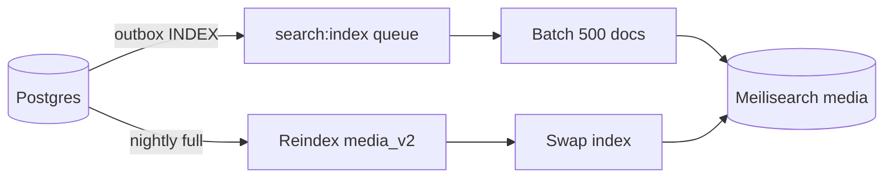

# 06 — Search Design

## 1. Goals

- A user types a half-remembered title in romaji, English, or Indonesian and finds it in the first three results.
- Typos and spacing variants do not produce an empty page.
- Filters (season, genre, platform, status) are fast and shareable via URL.
- Search is cheap enough to run on a 2 GB laptop at launch.
- The design can move to Meilisearch without changing the UI or API contract.

### Non-goals

- Natural-language question answering.
- Semantic/vector search at launch.
- Searching review bodies or user bios at launch.
- Personalized ranking (no accounts at launch).

---

## 2. Decision: Postgres FTS for MVP, Meilisearch later

| Option | Pros | Cons | Fit for 2 GB laptop |
|---|---|---|---|
| **Postgres FTS + pg_trgm** | No new service; transactional; one backup; good enough for 41k rows; familiar SQL | Weaker typo tolerance; no built-in facets/ranking UI; Indonesian stemming not built in | **Best** |
| **Meilisearch** | Excellent typo tolerance, fast facets, simple API, good relevance defaults, easy index rebuild | ~150–250 MB RAM; another service; eventual consistency; sync pipeline | Good on 4 GB VPS; tight on 2 GB |
| **Typesense** | Fast, strong filtering, vector support, good clustering | Another service; relevance tuning is more manual; similar RAM cost | Good on VPS |

**Recommendation:** ship the MVP on **Postgres FTS + trigram**, keep the search API contract stable, and add **Meilisearch** when the site moves to a VPS (Phase 3/4) or when typo complaints justify it. Do not run both at launch.

---

## 3. Postgres implementation (MVP)

### 3.1 Data shape

`media.search_text` is a denormalised text column maintained by the application:

```text
title_romaji
title_english
title_native
title_id
synonyms (space-joined)
genre names (Indonesian + English)
studio names
```

`media.search_vector` is generated:

```sql
ALTER TABLE media
  ADD COLUMN search_text text,
  ADD COLUMN search_vector tsvector
    GENERATED ALWAYS AS (to_tsvector('simple', coalesce(search_text, ''))) STORED;

CREATE INDEX media_search_vector_idx ON media USING GIN (search_vector);
CREATE INDEX media_title_romaji_trgm_idx ON media USING GIN (title_romaji gin_trgm_ops);
CREATE INDEX media_title_english_trgm_idx ON media USING GIN (title_english gin_trgm_ops);
CREATE INDEX media_title_id_trgm_idx ON media USING GIN (title_id gin_trgm_ops);
```

Use the `simple` configuration, not `english`: it avoids English stemming that mangles Japanese romanisation, and Indonesian stemming is not available by default. `unaccent` is applied in the query builder and, optionally, in a normalised copy of the titles.

### 3.2 Query pipeline

```text
raw query
  -> trim, lowercase, collapse whitespace
  -> remove dangerous operators, cap length (80 chars)
  -> expand synonyms (search_synonym)
  -> websearch_to_tsquery('simple', expanded)
  -> FTS match, rank with ts_rank_cd
  -> if 0 results, trigram similarity fallback
  -> apply filters (genre, season, platform, status, format)
  -> order by rank, then popularity
  -> paginate (20)
```

### 3.3 Ranking

```sql
WITH q AS (
  SELECT websearch_to_tsquery('simple', $1) AS tsq
)
SELECT
  m.id, m.slug, m.title_romaji, m.title_id, m.title_english,
  m.cover_url, m.score_avg, m.popularity, m.season, m.season_year,
  ts_rank_cd(m.search_vector, q.tsq) AS text_rank,
  (ts_rank_cd(m.search_vector, q.tsq) * 0.7
   + ln(1 + m.popularity) * 0.02
   + (m.score_avg / 10.0) * 0.1) AS rank
FROM media m, q
WHERE m.search_vector @@ q.tsq
  AND m.deleted_at IS NULL
  AND ($2::boolean IS NULL OR m.is_adult = $2)
ORDER BY rank DESC, m.popularity DESC
LIMIT $3 OFFSET $4;
```

- Popularity boost is small. Relevance wins.
- Exact title match should win: add a `CASE WHEN lower(m.title_romaji) = lower($1) THEN 1.0 ELSE 0 END` boost.
- Do not boost adult content.

### 3.4 Trigram fallback

When FTS returns zero results:

```sql
SELECT id, slug, title_romaji, title_id,
       greatest(
         similarity(title_romaji, $1),
         similarity(coalesce(title_english,''), $1),
         similarity(coalesce(title_id,''), $1)
       ) AS sim
FROM media
WHERE deleted_at IS NULL
  AND (title_romaji % $1 OR title_english % $1 OR title_id % $1)
ORDER BY sim DESC, popularity DESC
LIMIT 20;
```

Set `pg_trgm.similarity_threshold` per session (e.g., 0.25) or use `%` with a tuned threshold. Test with Indonesian and romaji queries.

### 3.5 Filters and facets

| Filter | SQL | Index |
|---|---|---|
| Genre | `EXISTS (SELECT 1 FROM media_genre mg WHERE mg.media_id = m.id AND mg.genre_id = $n)` | `media_genre(genre_id, media_id)` |
| Season/year | `m.season = $n AND m.season_year = $y` | `(season, season_year, popularity DESC)` |
| Status | `m.status = $n` | `(status, season_year DESC, popularity DESC)` |
| Format | `m.format = $n` | `(format)` |
| Platform | `EXISTS (SELECT 1 FROM streaming_link sl WHERE sl.media_id = m.id AND sl.platform_id = $n AND sl.status = 'ACTIVE')` | `streaming_link(platform_id, status)` |
| Has Indonesian synopsis | `m.id_content_status IN ('REVIEWED','PUBLISHED')` | `(is_adult, id_content_status)` |
| Score range | `m.score_avg >= $n` | `(score_avg DESC)` |
| Airing | `m.status = 'RELEASING'` | `(status)` |

Facet counts:

```sql
SELECT g.slug, g.name, count(*)::int
FROM media_genre mg
JOIN genre g ON g.id = mg.genre_id
JOIN media m ON m.id = mg.media_id
WHERE m.deleted_at IS NULL
  AND m.id_content_status IN ('REVIEWED','PUBLISHED')
GROUP BY g.slug, g.name
ORDER BY count(*) DESC;
```

Cache facet counts in Redis for 5 minutes; they change slowly. Do not count facets on every keystroke.

### 3.6 Synonyms for Indonesian users

`search_synonym` examples:

| term | synonyms |
|---|---|
| `aot` | `shingeki no kyojin`, `attack on titan`, `serangan raksasa` |
| `frieren` | `sousou no frieren`, `frieren beyond journeys end` |
| `jjk` | `jujutsu kaisen` |
| `kimetsu` | `demon slayer`, `kimetsu no yaiba` |
| `spy family` | `spy x family` |
| `isekai` | `another world`, `dunia lain` |
| `romance` | `romantis`, `cinta` |
| `slice of life` | `kehidupan sehari-hari` |

Keep synonyms editorial, not algorithmic. Avoid generic Indonesian words that appear in many titles.

### 3.7 API contract

`GET /api/search?q=&page=&genre=&season=&year=&platform=&status=&format=&sort=`

Response:

```json
{
  "query": "frieren",
  "total": 3,
  "page": 1,
  "pageSize": 20,
  "tookMs": 12,
  "results": [
    {
      "id": 123,
      "slug": "sousou-no-frieren",
      "title": "Sousou no Frieren",
      "titleId": "Frieren: Setelah Perjalanan Berakhir",
      "coverUrl": "...",
      "score": 8.9,
      "season": "FALL",
      "seasonYear": 2023,
      "platforms": ["bstation", "crunchyroll"]
    }
  ],
  "facets": { "genres": [], "platforms": [], "seasons": [] }
}
```

The UI must not depend on Postgres or Meilisearch-specific fields. The web app calls an internal `searchMedia()` function; only that function changes when Meilisearch is added.

### 3.8 Performance

- Target p95 < 80 ms for a 20-result query on the laptop.
- Use `EXPLAIN (ANALYZE, BUFFERS)` on the top 10 queries; add indexes only when measured.
- Cap `page * pageSize` at 1,000; deeper pages are rare and expensive.
- Cache the first page of popular queries in Redis for 60 seconds.
- Do not run `count(*)` on every keystroke; show “24+ hasil” or fetch the count after a 300 ms pause.

---

## 4. Meilisearch target design (Phase 3/4)

### 4.1 Index

- Index name: `media`
- Primary key: `id` (string of the numeric media id)
- One document per media
- Rebuildable from Postgres at any time

### 4.2 Document shape

```json
{
  "id": "123",
  "slug": "sousou-no-frieren",
  "title_romaji": "Sousou no Frieren",
  "title_english": "Frieren: Beyond Journey's End",
  "title_native": "葬送のフリーレン",
  "title_id": "Frieren: Setelah Perjalanan Berakhir",
  "synonyms": ["frieren", "sousou no frieren"],
  "genre_names": ["Fantasy", "Adventure", "Drama"],
  "genre_slugs": ["fantasy", "adventure", "drama"],
  "studio_names": ["Madhouse"],
  "studio_slugs": ["madhouse"],
  "platform_slugs": ["bstation", "crunchyroll"],
  "format": "TV",
  "status": "FINISHED",
  "season": "FALL",
  "season_year": 2023,
  "episodes": 28,
  "score_avg": 8.9,
  "popularity": 98231,
  "start_date": "2023-09-29",
  "is_adult": false,
  "has_synopsis_id": true,
  "cover_url": "https://..."
}
```

### 4.3 Settings

```json
{
  "searchableAttributes": [
    "title_id",
    "title_romaji",
    "title_english",
    "title_native",
    "synonyms",
    "studio_names",
    "genre_names"
  ],
  "filterableAttributes": [
    "format",
    "status",
    "season",
    "season_year",
    "genre_slugs",
    "studio_slugs",
    "platform_slugs",
    "is_adult",
    "has_synopsis_id",
    "score_avg",
    "episodes",
    "start_date"
  ],
  "sortableAttributes": [
    "score_avg",
    "popularity",
    "start_date",
    "episodes",
    "title_romaji"
  ],
  "rankingRules": [
    "words",
    "typo",
    "proximity",
    "attribute",
    "sort",
    "exactness"
  ],
  "typoTolerance": {
    "enabled": true,
    "minWordSizeForTypos": { "oneTypo": 5, "twoTypos": 9 },
    "disableOnWords": [],
    "disableOnAttributes": ["season_year"]
  },
  "faceting": {
    "maxValuesPerFacet": 100,
    "sortFacetValuesBy": { "*": "count" }
  },
  "pagination": { "maxTotalHits": 1000 },
  "separatorTokens": ["|", "・", "／"],
  "nonSeparatorTokens": ["'"],
  "stopWords": ["yang", "dan", "di", "ke", "dari", "untuk", "dengan", "itu", "ini"],
  "synonyms": {
    "aot": ["shingeki no kyojin", "attack on titan"],
    "frieren": ["sousou no frieren"],
    "jjk": ["jujutsu kaisen"],
    "kimetsu": ["demon slayer", "kimetsu no yaiba"]
  }
}
```

**Stop words caution:** Indonesian stop words are safe for prose, but anime titles contain short particles (`no`, `wa`, `ga`, `di`). Do not add Japanese particles as stop words. Test `Kimi no Na wa`, `Di Balik Cahaya`, and `Sousou no Frieren` before enabling the list. If in doubt, ship with an empty `stopWords` array.

### 4.4 Ranking intent

| Query | Expected top result | Why |
|---|---|---|
| `frieren` | Sousou no Frieren | Exact/synonym + popularity |
| `sousou no frieren` | Sousou no Frieren | Exact title |
| `frieren beyond` | Sousou no Frieren | English title |
| `jujutsu` | Jujutsu Kaisen | Exact prefix |
| `jjk` | Jujutsu Kaisen | Synonym |
| `demon slayer` | Kimetsu no Yaiba | English title |
| `kimetsu` | Kimetsu no Yaiba | Romaji prefix |
| `spy family` | Spy x Family | Tokenization/synonym |
| `isekai 2026` | Isekai anime from 2026 | Filter + query |
| `anime tayang hari ini` | Schedule page, not media | Route intent; show a schedule suggestion |

### 4.5 Sync pipeline



- Incremental: `addDocuments` with the full document for changed IDs; idempotent by `id`.
- Deletes: `deleteDocuments([id])`; never leave orphaned documents.
- Full reindex: build `media_v2` with settings, wait for `status = processed`, swap `media_v2` → `media`, then delete the old index. Zero downtime.
- Settings changes are versioned in code; apply before the swap.
- Monitor `numberOfDocuments`, `isIndexing`, `fieldDistribution`, and search latency.
- If Meilisearch is unavailable, fall back to Postgres FTS. The UI does not show an error unless both fail.

---

## 5. Search UX

| Behaviour | Detail |
|---|---|
| Trigger | 2+ characters; debounce 150 ms |
| Cancel | Abort previous request with `AbortController` |
| Results | 6 suggestions in the dialog; full results on Enter |
| Keyboard | ↑/↓ to move, Enter to open, Esc to close |
| Recent searches | Local only (no account), max 5, clear button |
| Highlight | Bold matched title fragment, accessible `<mark>` |
| Empty | “Tidak ditemukan. Coba ejaan lain atau jelajahi musim ini.” |
| Loading | Inline skeleton rows, not a spinner |
| Mobile | Full-screen sheet, input autofocus, close button |
| Screen reader | `role="combobox"`, `aria-expanded`, `aria-activedescendant`, live region for count |
| Analytics | Query length bucket + result count, not raw query tied to a user |
| Piracy intent | If query contains “sub indo”, “download”, “batch”, still show legal results and a note: “Nimelist hanya menampilkan platform legal.” Never link to pirate sites |

---

## 6. Indonesian search specifics

1. **Romanisation variants:** `ou` vs `o`, `uu` vs `u`, `sh` vs `sy`, macrons. Add synonyms for the top 200 titles; do not build a general transliteration engine.
2. **Word boundaries:** Japanese titles often use `no`, `wa`, `ga`; keep them as tokens.
3. **English/Indonesian mix:** users may type “anime tentang penyihir” or “fantasy magic”. Genre names and synonyms should cover both.
4. **Typos:** Indonesian users often drop letters (`frieren` → `freren`). Trigram/Meilisearch typo tolerance handles this.
5. **Diacritics:** `Pokémon` vs `Pokemon`; apply `unaccent` in Postgres and enable Meilisearch's default normalization.
6. **Numbers:** `season 2`, `musim 2`, `2nd season`. Index `synonyms` with these variants for popular series.
7. **“Sub indo” intent:** never claim to provide streaming. Show legal availability and a short explanation.

---

## 7. Relevance test suite

Maintain a fixture of 30–50 golden queries and expected top-3 slugs. Run it in CI against a seeded test database (or Meilisearch snapshot). Fail the build if top-1 accuracy drops below 80% or top-3 below 95%.

| Query | Must include in top 3 |
|---|---|
| `frieren` | `sousou-no-frieren` |
| `sousou no frieren` | `sousou-no-frieren` |
| `jjk` | `jujutsu-kaisen` |
| `demon slayer` | `kimetsu-no-yaiba` |
| `spy x family` | `spy-x-family` |
| `one piece` | `one-piece` |
| `isekai 2026` | at least 3 isekai 2026 titles |
| `anime tayang hari ini` | schedule page suggestion |
| `film anime 2025` | movie format 2025 |
| `netflix anime` | platform `netflix` results |

---

## 8. Capacity and operations

| Metric | Postgres MVP | Meilisearch target |
|---|---|---|
| Documents | 41k rows | 41k docs |
| RAM | Included in Postgres | 150–250 MB |
| Index size | 200–500 MB | 50–150 MB |
| Reindex time | < 2 min | < 1 min |
| Backup | `pg_dump` | Rebuild from Postgres; no backup needed |
| Failure mode | Query error | Fallback to Postgres |

- Add a `search:health` check to `/api/health` when Meilisearch is enabled.
- Log slow queries (> 200 ms) with the sanitized query and plan.
- Review zero-result queries weekly and add synonyms/aliases; do not add spam pages.
