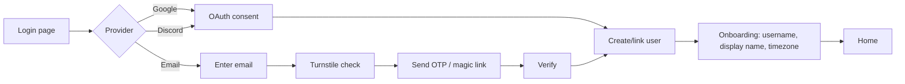
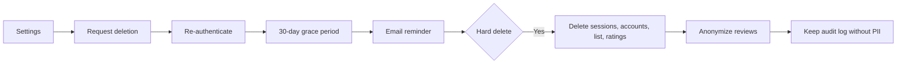
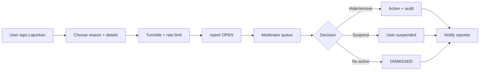

# 07 — Auth, User Data, Community, and Moderation

## 1. Auth decision

**Use Better Auth 1.7.x** with the Prisma adapter.

| Option | Status | Assessment |
|---|---|---|
| **Better Auth 1.7.x** | Stable | Supports Next 16, React 19, Prisma 7; built-in email OTP, OAuth, sessions, rate limiting, admin/ban, account linking. **Recommended.** |
| Auth.js v5 | `5.0.0-beta.32` | Good ecosystem, but still beta and slower to support Next 16. Acceptable only with a pinned beta and a one-day spike. |
| Auth.js v4 | Stable | Older App Router patterns; weaker fit for Cache Components. |
| Custom sessions | — | Highest security/maintenance burden. Not justified. |

If the team later insists on Auth.js, keep the `user`/`session`/`account` semantics close to Better Auth's schema so a migration is possible. Do not mix both libraries.

---

## 2. Auth flows

### 2.1 Sign-up / login



- **Providers:** Google, Discord, email OTP/magic link.
- **No passwords at launch.** Passwordless avoids password storage, breach risk, and reset flows. Add passwords later only if users demand it, with Argon2id and breach-list checks.
- **Email verification:** required before posting reviews/reports. Reading the catalog does not require an account.
- **Account linking:** same verified email can link Google + Discord + email. Do not auto-link unverified emails.
- **Onboarding:** choose `username` (unique, 3–20 chars, `[a-z0-9_]`), display name, timezone (default `Asia/Jakarta`), language (default `id`), and privacy defaults.
- **Terms acceptance:** explicit checkbox at sign-up, recorded with version and timestamp.

### 2.2 Session strategy

- **Database sessions** (not JWT): revocable, supports ban/account deletion, and works with server-side checks.
- Cookie: `HttpOnly`, `Secure`, `SameSite=Lax`, `Path=/`, 30-day rolling expiry.
- Rotate session on login, email change, role change, and ban/unban.
- Store `ip_address` and `user_agent` for abuse investigation; do not expose them publicly.
- Limit active sessions per user (e.g., 10); allow “logout all devices”.
- Clean up expired sessions daily.

### 2.3 Cache Components integration

With `cacheComponents: true`, session reads happen at request time and cannot be part of the static shell.

```tsx
// app/(shell)/header.tsx
import { Suspense } from "react";

export function Header() {
  return (
    <header>
      <Logo />
      <Suspense fallback={<HeaderSkeleton />}>
        <UserMenu />
      </Suspense>
    </header>
  );
}
```

- `UserMenu` reads the session and renders login/avatar.
- Do not call `cookies()` in a cached component.
- If a cached function needs the user id, pass it as an argument and use `use cache: private` for per-user data.
- Never cache a session object on the server.
- For watchlist status on a detail page, wrap `AddToList` in `<Suspense>`; the public page remains cached.

---

## 3. User data model

Better Auth owns the base fields. Extend `user` with:

| Field | Purpose |
|---|---|
| `username` | Public handle, unique |
| `display_name` | Display name |
| `bio` | Short profile text, sanitized |
| `role` | `USER`, `MODERATOR`, `ADMIN` |
| `status` | `ACTIVE`, `SUSPENDED`, `DELETED` |
| `locale` | `id` at launch |
| `timezone` | `Asia/Jakarta` default |
| `profile_public` | Opt-in to indexable profile |
| `list_visibility` | `PUBLIC`, `FOLLOWERS`, `PRIVATE` |
| `show_adult` | Adult content preference |
| `banned`, `ban_reason`, `ban_expires` | Better Auth admin plugin |
| `created_at`, `updated_at`, `deleted_at` | Lifecycle |

Full schema: `04-database.md`.

### 3.1 Privacy defaults

| Setting | Default | Notes |
|---|---|---|
| Profile public | `false` until onboarding choice | If false, `noindex` and not listed |
| List visibility | `PRIVATE` | Users opt in to public lists |
| Notes | Private | Never exposed via public API |
| Reviews | Public when published | Author can hide/delete |
| Show adult | `false` | Age gate required to enable |
| Analytics | Aggregated only | No raw search history tied to user |

### 3.2 Public profile rules

- Public profile is indexable only if `profile_public = true` and the user has at least one public list/review.
- Private profile returns 200 with a “private” message but `noindex`.
- Do not expose email, IP, session, or OAuth IDs.
- Username changes: 301 from old username for 30 days, then release the old handle. Keep a `username_history` table if abuse becomes an issue.
- Blocked users: hide each other’s reviews (later).

---

## 4. Account deletion and data export

### 4.1 Deletion flow



- Re-authenticate before deletion (OAuth or email OTP).
- 30-day grace period with a cancel link.
- Hard delete: `session`, `account`, `list_entry`, `follow`, ratings, notifications.
- Reviews: either delete or anonymize (`user_id` set to a tombstone, author shown as “Akun dihapus”). Respect the user’s choice; default anonymize to preserve community content.
- Audit log retains the action, not the PII.
- Backups expire within 30 days; document this in the privacy policy.
- Do not delete aggregate counts that are not personally identifiable.

### 4.2 Data export

- JSON export of profile, list entries, ratings, reviews, follows.
- Rate limit: once per 24 hours.
- Deliver via a signed, expiring download link (R2/S3), not email attachment.
- Include a README explaining the schema.

### 4.3 Legal retention

- Tax/payment records (premium later) may require retention; keep them separate from profile data.
- Abuse/audit logs: 2 years, minimised.
- Privacy policy must state retention periods and the deletion process.

---

## 5. Import and sync (Phase 4)

### 5.1 MAL import

- Use the official MyAnimeList API v2 OAuth flow. Never scrape.
- Scope: read user’s anime list; write only if the user opts into two-way sync.
- Map MAL IDs to `external_id(provider='MAL')`.
- Import status, score, progress, start/finish dates, notes (if available).
- Conflict policy: “keep newest” or “prefer Nimelist”; show a preview before committing.
- Rate limit per user; one import job at a time; progress UI.
- Store the import summary in `sync_log` with `provider='MAL'`.

### 5.2 AniList sync

- Only after written AniList permission.
- OAuth with `read`/`write` scopes as approved.
- Two-way sync is the strongest argument for permission, but it increases conflict complexity. Start one-way import, then add push sync.
- Conflict resolution: last-write-wins with a visible “last synced” timestamp; never silently overwrite a Nimelist-only note.
- Provide a kill switch and a full disconnect that deletes stored tokens.

### 5.3 Mapping quality

- Match by provider external ID first.
- Fallback: normalized title + year + episodes, with a confidence score.
- Never auto-merge two media with user data; present candidates to the user/admin.
- Unmatched rows go to a review queue, not silently dropped.

---

## 6. Ratings and reviews

### 6.1 Ratings

- One score per user per media, `1.0–10.0` in 0.5 steps (or integers for simplicity).
- Updating a score updates `media.score_avg` and `score_count` via a transactional job or materialized view.
- Anti-brigading: account age ≥ 24 h, email verified, rate limit, anomaly detection on bursts.
- Do not show a score until `score_count >= 5`; show “Belum cukup penilaian”.
- Do not use provider ratings as Nimelist ratings. Store external scores separately if licensed.

### 6.2 Review rules (Indonesian)

1. Write in Indonesian (or English with an Indonesian summary; decide later).
2. Minimum 150 characters; maximum 10,000.
3. One active review per user per media.
4. Mark spoilers; the UI hides them until clicked.
5. No piracy links, requests for pirate links, or “where to download”.
6. No harassment, hate speech, doxxing, or threats.
7. No plagiarism; quote at most a short passage with attribution.
8. Disclose AI assistance if the text is substantially AI-generated.
9. No spam, affiliate links, or SEO manipulation.
10. Moderators may edit titles for clarity, hide, remove, or suspend.

### 6.3 Rating/review display

- Review page shows score, spoiler flag, author, date, helpful count.
- Aggregate score is Bayesian-smoothed for small samples:
  `weighted = (sum_scores + prior_mean * prior_weight) / (count + prior_weight)`, with `prior_mean = 7.0`, `prior_weight = 20`.
- Sort reviews by helpful/newest; default “Terbaru”.
- “Helpful” requires an account and is rate-limited; one vote per user per review.
- Do not allow downvotes at launch; they invite abuse.

---

## 7. Moderation

### 7.1 Roles

| Role | Capabilities |
|---|---|
| `USER` | Read, list, rate, review (after verification), report |
| `MODERATOR` | Hide/remove reviews, handle reports, warn/suspend users, view audit log |
| `ADMIN` | Everything, roles, provider flags, deletions, settings, exports |

- Admin accounts require 2FA (TOTP) before production.
- No public “admin” label; show “Moderator” only when useful.
- Separation: a moderator cannot moderate their own content; an admin must handle it.

### 7.2 Report flow



- Reasons: spam, harassment, hate, spoiler without flag, piracy link, plagiarism, misinformation, other.
- SLA: first response within 72 hours; urgent threats within 24 hours.
- Reporter notification is generic; do not reveal moderator identity.
- Appeals: one appeal per action, reviewed by a different moderator.
- Transparency page: aggregate counts, not individual cases.

### 7.3 Anti-spam

| Control | Detail |
|---|---|
| Cloudflare Turnstile | Sign-up, magic link, first review, reports |
| Email verification | Required before UGC |
| Account age | 24 h before reviewing; 7 days before links |
| Redis rate limits | 3 reviews/day, 10 reports/day, 20 ratings/day, 5 auth attempts/10 min/IP |
| Link limits | New users: 0 links; trusted: 2 links, `nofollow ugc` |
| Duplicate detection | SimHash/MinHash on review body; reject near-duplicates |
| Honeypot | Hidden field in forms; reject if filled |
| Shadow ban | Content visible to author only; no notification |
| First-post moderation | First review goes to `PENDING` |
| Device/IP signals | Hash IPs; do not store raw longer than needed |
| CAPTCHA escalation | After 2 failed attempts, require Turnstile |

### 7.4 Sanitization

- Store Markdown source; render with `remark` → `rehype-sanitize` → HTML.
- Allowlist: paragraphs, headings, bold/italic, lists, blockquotes, code, links.
- No raw HTML, no `<script>`, no `<iframe>`, no images in reviews at launch.
- Links: `rel="nofollow ugc noopener noreferrer"`, `target="_blank"` optional.
- Escape JSON-LD (`<` → `\u003c`).
- CSP blocks inline scripts except the nonce/hash for the theme bootstrap.
- Bio and display names are plain text, not HTML.

---

## 8. Notifications (later)

- Email: verification, passwordless login, review approved/rejected, report outcome, account deletion.
- In-app: bell with unread count (Phase 4).
- Preferences: email on/off per category; digest weekly.
- Never email marketing without explicit opt-in.
- Use a transactional provider with SPF, DKIM, DMARC; monitor bounce/complaint rates.
- Unsubscribe link in every non-transactional email.

---

## 9. Abuse and threat scenarios

| Scenario | Impact | Mitigation |
|---|---|---|
| Credential stuffing on email OTP | Account takeover | Rate limit, Turnstile, short OTP expiry, device alerts |
| OAuth account takeover | Impersonation | Verify email, link only verified emails, 2FA for admins |
| Review bombing | Reputation damage | Account age, rate limits, Bayesian score, anomaly detection |
| Spam links | SEO/legal risk | Link limits, `nofollow`, moderation, Turnstile |
| Harassment | User harm | Report flow, block, suspension, guidelines |
| Impersonation | Trust | Username policy, verified badge later, report |
| Scraping user data | Privacy | Rate limits, auth, no public API, bot management |
| Admin account compromise | Full control | 2FA, least privilege, audit log, IP allowlist for admin |
| Deleted user data in backups | Privacy | 30-day backup expiry, documented policy |
| CSRF on Server Actions | State change | Better Auth CSRF, same-site cookies, origin checks |
| Open redirect after login | Phishing | Validate `next` is a local path |

---

## 10. Legal and policy pages

Required before UGC:

- **Kebijakan Privasi** (UU PDP): data collected, purpose, legal basis, retention, rights, processors, cross-border transfer, contact/DPO.
- **Ketentuan Layanan**: eligibility (13+ or 17+), account responsibilities, acceptable use, termination, IP, liability.
- **Pedoman Komunitas**: review rules, spoiler policy, harassment, piracy, enforcement, appeals.
- **Kebijakan Hak Cipta**: takedown process, counter-notice, repeat infringer policy.
- **Cookie Policy**: analytics/ads cookies, consent.
- **Disclaimer**: not affiliated with studios/platforms; no streaming; data accuracy.
- **Contact/DPO**: real channel and response time.

Indonesian law notes:

- **UU PDP (Law 27/2022):** consent, purpose limitation, data minimisation, breach notification within 3×24 hours, DPO if processing meets criteria, cross-border transfer safeguards.
- **PSE registration:** private-scope electronic system operators serving Indonesian users must register under PP 71/2019 and Permenkominfo 5/2020 (verify current rules with counsel).
- **UU ITE (as amended by Law 1/2024):** content takedown obligations, child protection, platform responsibility.
- **Age:** set minimum 13+ with parental consent notice; if that is hard to enforce, set 17+ for UGC. Decide with counsel.
- **Children’s data:** no targeted ads to minors; no public profiles for under-17 by default.

---

## 11. Implementation checklist

- [ ] Better Auth installed and pinned; Prisma adapter generated.
- [ ] `user` extended with Nimelist fields; migration applied.
- [ ] Google and Discord OAuth apps created; redirect URIs configured.
- [ ] Transactional email configured (SPF/DKIM/DMARC).
- [ ] Email OTP/magic link tested on mobile and desktop.
- [ ] Session cookie flags verified in production.
- [ ] Turnstile keys configured; server verification.
- [ ] Redis rate limits for auth and UGC.
- [ ] Onboarding username validation and reserved names.
- [ ] Privacy defaults applied.
- [ ] Account deletion + export tested.
- [ ] Admin 2FA enforced.
- [ ] Audit log writes for role/ban/content actions.
- [ ] Markdown sanitization tests (XSS payloads).
- [ ] Legal pages published in Indonesian.
- [ ] PSE registration reviewed with counsel.
