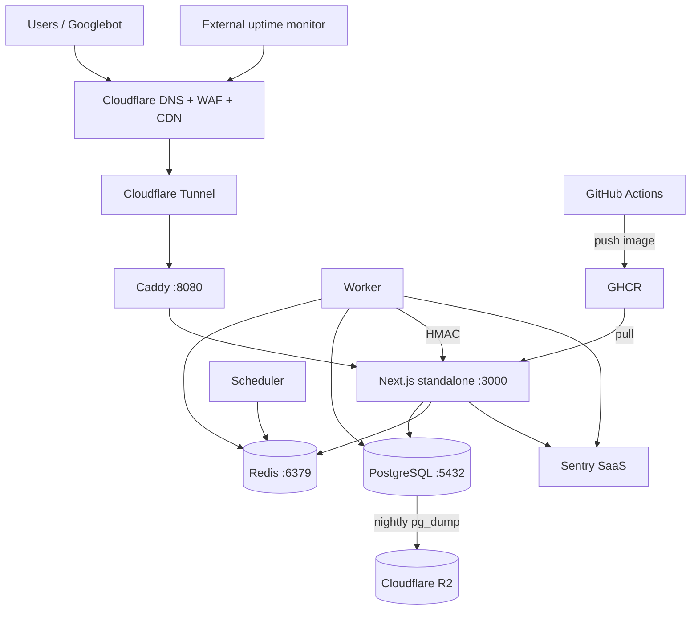
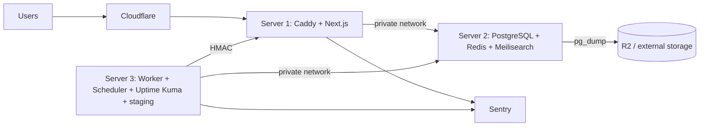
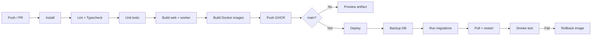

# 08 — Architecture and Infrastructure

## 1. Principles

1. **Modular monolith + worker.** One web deployable, one worker, one scheduler. No microservices, no Kubernetes.
2. **Visitors read from our database.** External APIs are worker-only.
3. **One public entry point.** Cloudflare → Caddy → Next.js. No database port exposed.
4. **Build where there is RAM.** The 2 GB laptop builds nothing; GitHub Actions builds images and the laptop pulls them.
5. **Everything must restore.** A backup that has not been restored is a hope, not a backup.
6. **Upgrade by moving hosts, not rewriting code.** The same Compose profiles run on the laptop, a VPS, or the 3-server target.

---

## 2. Component map

| Component | Responsibility | Launch host | Target host |
|---|---|---|---|
| Cloudflare | DNS, WAF, DDoS, CDN, Tunnel | External | External |
| Caddy | TLS termination, reverse proxy, compression, security headers | Laptop | Server 1 |
| Next.js web | SSR/RSC, routes, Server Actions, auth | Laptop | Server 1 |
| PostgreSQL | Source of truth | Laptop | Server 2 |
| Redis | BullMQ queues, rate limits, cache | Laptop | Server 2 |
| BullMQ worker | Jobs, provider sync, outbox | Laptop | Server 3 |
| Scheduler | Repeatable job registration | Laptop | Server 3 |
| Meilisearch | Search (Phase 3/4) | Disabled | Server 2 |
| Cloudflare R2 | Encrypted backups, exports | External | External |
| Sentry | Error tracking (SaaS free tier) | External | External |
| Uptime monitor | External HTTP/TCP/heartbeat checks | External | External |
| GitHub Actions | CI, image build, migrations | External | External |
| GHCR | Container registry | External | External |

---

## 3. Network diagram

### 3.1 Launch (laptop, Cloudflare Tunnel)



- No inbound ports on the home router. `cloudflared` makes an outbound tunnel.
- Caddy binds `127.0.0.1:8080`; only the tunnel reaches it.
- Postgres and Redis bind `127.0.0.1`, never `0.0.0.0`.
- Docker network `internal` for DB/Redis; `web` network for Caddy/Next.

### 3.2 Target (3 servers)



- Only Server 1 has a public IP/ports 80/443.
- Server 2 accepts connections only from Server 1 and Server 3 on the private network.
- Server 3 has egress for providers and monitoring; no public web.
- Staging runs on Server 3 with a separate database and a `staging.` hostname protected by Cloudflare Access.

---

## 4. Launch profile: 2 GB RAM / 10 GB disk

### 4.1 Memory budget

| Service | Limit | Notes |
|---|---|---|
| OS + Docker | 400–600 MB | Depends on distro |
| Caddy | 30 MB | |
| Next.js standalone | 250 MB | 1 instance |
| PostgreSQL | 300 MB | `shared_buffers=256MB` |
| Redis | 64 MB | `maxmemory 64mb`, no persistence |
| Worker | 120 MB | Concurrency 2 |
| Scheduler | 60 MB | |
| **Total** | **~1.2–1.5 GB** | Leaves ~500 MB headroom + 4 GB swap |
| Meilisearch | **disabled** | Would add 150–250 MB |
| Self-hosted Sentry/Uptime Kuma | **disabled** | Use SaaS free tiers |

Set `mem_limit` in Compose for each service. Add a 4 GB swapfile; it is a safety net, not performance. Set `vm.swappiness=10`.

### 4.2 Disk budget

| Item | Estimate |
|---|---|
| OS + Docker engine | 3–4 GB |
| Images (web, worker, Caddy, Postgres, Redis) | 2–3 GB |
| `node_modules` (dev only) | 0.5 GB |
| Postgres data + WAL | 1–2 GB |
| Logs (rotated) | 0.3 GB |
| **Total** | **~7–9 GB** |
| Free space guardrail | **≥ 1.5 GB** |

No local backups. No Meilisearch. No build cache on the laptop. Prune Docker weekly. Rotate logs at 10 MB × 5.

### 4.3 What the laptop is and is not

**Suitable for:**

- Private beta, SEO sandbox, curation testing.
- A handful of concurrent users.
- Demonstrating the product to early users.

**Not suitable for:**

- Public launch with traffic spikes.
- Guaranteed uptime (sleep, power, ISP, CGNAT, disk failure).
- Large media/image caching.
- Running CI builds or Meilisearch.

**Phase 3 gate:** move to a 4 GB / 40 GB VPS (~$5–10/month) before public launch, or explicitly accept beta-only reliability. Cloudflare Tunnel makes the move a DNS/tunnel change, not a rewrite.

---

## 5. Target profile: 3 servers

| Server | Spec (minimum) | Services | Notes |
|---|---|---|---|
| Server 1 (App) | 2 vCPU / 4 GB / 40 GB | Caddy, Next.js | Public; Cloudflare proxied |
| Server 2 (Data) | 2 vCPU / 8 GB / 80 GB | PostgreSQL, Redis, Meilisearch | Private network only; backups |
| Server 3 (Worker) | 2 vCPU / 4 GB / 40 GB | Worker, scheduler, Uptime Kuma, staging | Egress; no public web |

- Use a private network (Hetzner private network, WireGuard, or Tailscale) between servers.
- Firewall: default deny inbound; allow 22 from admin IP, 80/443 on Server 1, DB ports only from private IPs.
- SSH keys only; disable password auth; fail2ban; unattended security updates.
- Separate Docker Compose file per server, from the same repo.
- Staging on Server 3 uses a separate database, Redis DB index, and hostname.

---

## 6. Repository structure

Use **npm workspaces**, not Turborepo/Nx. The repo is small; a task runner adds configuration without enough benefit.

```text
nimelist/
├── apps/
│   ├── web/                  # Next.js 16 App Router
│   │   ├── app/
│   │   ├── components/
│   │   ├── lib/
│   │   ├── public/
│   │   └── next.config.ts
│   └── worker/               # BullMQ worker + scheduler
│       ├── src/jobs/
│       ├── src/providers/
│       └── src/index.ts
├── packages/
│   ├── db/                   # Prisma schema, migrations, seed, client
│   ├── core/                 # domain services, Zod schemas, pure logic
│   ├── providers/            # provider adapters + normalized DTOs
│   ├── ui/                   # shared shadcn/ui components (if needed)
│   └── config/               # eslint, tsconfig, env schema
├── deploy/
│   ├── compose.lean.yml
│   ├── compose.app.yml
│   ├── compose.data.yml
│   ├── compose.worker.yml
│   ├── Caddyfile
│   └── cloudflared/
├── docs/                     # copy of this plan during implementation
├── .github/workflows/
├── package.json
└── package-lock.json
```

### Why a workspace monorepo

- The worker and web share the Prisma schema, domain types, and provider code.
- One lockfile, one CI, one version of Zod/Prisma.
- Without workspaces, the worker would import from `apps/web/src`, mixing runtimes and build targets.

**Trade-off:** slightly more setup (workspace scripts, hoisting). Not enough to justify Turborepo, Nx, or a separate repo.

### Scripts

```json
{
  "scripts": {
    "dev": "npm run dev -w @nimelist/web",
    "build": "npm run build -w @nimelist/web && npm run build -w @nimelist/worker",
    "lint": "npm run lint --workspaces --if-present",
    "typecheck": "npm run typecheck --workspaces --if-present",
    "test": "npm run test --workspaces --if-present",
    "db:migrate": "npm run db:migrate -w @nimelist/db",
    "db:seed": "npm run db:seed -w @nimelist/db"
  }
}
```

---

## 7. Docker Compose

### 7.1 Lean launch (`compose.lean.yml`)

Services:

- `caddy` — ports `127.0.0.1:8080:8080`, config mount.
- `web` — image from GHCR, `NODE_ENV=production`, `mem_limit=300m`, healthcheck `/api/health`.
- `postgres` — volume `pgdata`, `shared_buffers=256MB`, `mem_limit=400m`.
- `redis` — `maxmemory 64mb`, `maxmemory-policy allkeys-lru`, no AOF, `mem_limit=80m`.
- `worker` — image from GHCR, `mem_limit=160m`, depends on postgres/redis.
- `scheduler` — same image as worker, different command, `mem_limit=80m`.
- `cloudflared` — tunnel token, `network_mode: host` or a dedicated network.

All services: `restart: unless-stopped`, `logging` json-file `max-size: 10m`, `max-file: "5"`, `healthcheck`.

### 7.2 Target profiles

- `compose.app.yml`: Caddy + web.
- `compose.data.yml`: Postgres + Redis + Meilisearch.
- `compose.worker.yml`: worker + scheduler + Uptime Kuma.
- Shared `.env` per host, secrets via Docker secrets or SOPS/age; never commit `.env`.

### 7.3 Healthchecks

| Service | Check |
|---|---|
| web | `GET /api/health` returns 200 and DB `SELECT 1` |
| postgres | `pg_isready` |
| redis | `redis-cli ping` |
| worker | heartbeat key in Redis updated every 30 s |
| caddy | `GET /healthz` |
| cloudflared | process alive + tunnel metrics |

---

## 8. CI/CD

### 8.1 Pipeline



### 8.2 Rules

- **Build on GitHub Actions, not the laptop.** The laptop only pulls images.
- **Migrations are a separate step.** Never run `prisma migrate deploy` in the web container entrypoint. A failed migration must not start a half-broken app.
- **Backup before migrate.** Abort deploy if the backup fails.
- **Advisory lock.** Only one migration job at a time.
- **Smoke test:** `/api/health`, home 200, a known detail 200, sitemap 200.
- **Rollback:** redeploy the previous image tag; migrations must be backward-compatible for one release (expand/contract).
- **Secrets:** GitHub Environments with required reviewers for production.
- **Images:** tag with commit SHA and `latest`; deploy by SHA.

### 8.3 Deploy commands (lean)

```bash
docker compose -f deploy/compose.lean.yml pull web worker scheduler
docker compose -f deploy/compose.lean.yml run --rm web npx prisma migrate deploy
docker compose -f deploy/compose.lean.yml up -d --no-deps web worker scheduler
curl -fsS https://nimelist.id/api/health
```

For a single-host restart, a short maintenance page is acceptable. On the target profile, use rolling restarts with Caddy health checks.

---

## 9. Backups and restore

### 9.1 Policy

| Item | Policy |
|---|---|
| Database | Daily `pg_dump -Fc` at 03:00 WIB |
| Encryption | `age` or GPG before upload |
| Destination | Cloudflare R2 (private bucket), lifecycle rules |
| Retention | 30 daily, 12 weekly, 6 monthly |
| RPO | 24 hours |
| RTO | 4 hours |
| Restore test | Monthly to staging; record time and issues |
| Redis | No backup; queues re-enqueued |
| Meilisearch | No backup; rebuild from Postgres |
| Images | Source CDN; no local backup |

### 9.2 Restore runbook

1. Provision a clean Postgres (staging or new volume).
2. Download the latest dump and checksum from R2.
3. `pg_restore --clean --if-exists -d nimelist dump.pgc`.
4. Run `prisma migrate deploy` only if the dump predates migrations.
5. Start the app against the restored DB.
6. Smoke test: home, detail, schedule, sitemap, login (if enabled).
7. Record restore duration and data loss window in the ops log.
8. Rotate the test DB credentials after the test.

### 9.3 Backup monitoring

- Uptime monitor heartbeat after success.
- Alert if no successful backup in 26 hours.
- Check dump size is within 20% of the 7-day average; a sudden drop means failure.
- Store a SHA-256 checksum next to each dump.

---

## 10. Observability

| Signal | Tool | Notes |
|---|---|---|
| Exceptions | Sentry (web + worker) | Free tier; release = commit SHA |
| Uptime | External monitor (Better Stack/UptimeRobot) | HTTPS + keyword check |
| Job heartbeat | Uptime monitor push | One per critical job |
| Logs | Docker json-file + `docker logs` | Rotated; no PII |
| Metrics | Cloudflare analytics + Postgres `pg_stat_statements` | Keep simple |
| Core Web Vitals | RUM beacon + CrUX | p75 mobile |
| Backups | Heartbeat + size check | Critical alert |
| Disk/memory | Cron script → webhook | Alert at 80% disk / 90% RAM |

### Logging rules

- JSON logs with `level`, `time`, `service`, `route`, `job`, `runId`, `durationMs`.
- Never log emails, tokens, cookies, IPs (hash if needed), or full request bodies.
- Include `requestId` and propagate to worker jobs.
- Sentry `beforeSend` scrubs PII.

---

## 11. Deployment runbooks

### 11.1 First deploy

1. Provision host, create user, SSH keys, firewall.
2. Install Docker + Compose.
3. Create `deploy/.env` from `.env.example`; generate secrets.
4. Start Postgres + Redis; wait for health.
5. Run migrations; seed ODbL.
6. Start web + worker + scheduler.
7. Configure Cloudflare Tunnel and DNS.
8. Verify HTTPS, `/api/health`, sitemap, robots.
9. Enable backups; run a restore test.
10. Submit sitemap to Search Console.

### 11.2 Update

1. CI builds and pushes image by SHA.
2. Backup DB.
3. Pull image.
4. Run migrations (if any).
5. Restart web/worker.
6. Smoke test.
7. Watch Sentry/uptime for 15 minutes.

### 11.3 Incident

1. Check uptime monitor and Sentry.
2. If the app is down: check disk, memory, Docker, Postgres.
3. If data is corrupt: stop writes, restore latest backup.
4. If a bad deploy: roll back image; migrations are backward-compatible.
5. Communicate status to users if > 30 minutes.
6. Write a blameless post-mortem in `docs/incidents/`.

---

## 12. Scaling path

| Trigger | Action |
|---|---|
| Public launch | Move to 4 GB VPS; keep lean profile |
| Search complaints | Add Meilisearch on 8 GB data VPS |
| > 100k monthly visits | Separate worker server; add Cloudflare cache rules |
| DB > 20 GB or slow queries | Add PgBouncer, read replica, partition logs |
| Media image bandwidth | Cloudflare image resizing or a dedicated image proxy |
| Uptime SLA | Managed Postgres or primary/standby; PITR |
| Team growth | Add staging + preview environments; consider Turborepo only then |

Do not add a service before the trigger. The laptop is a validation environment, not a destination.
