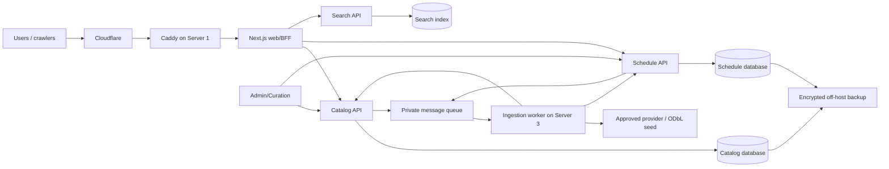

# 08 — Microservices Architecture and Infrastructure

**Status:** Target architecture for the required three-server deployment. This is a design; the current beta is still a Next.js + SQLite monolith.

## 1. Architecture principles

1. The assignment requires independently deployable microservices, so each domain service has its own process, API contract, data ownership, and deployment image.
2. Keep the service count small. Start with Catalog, Schedule, Search, and Ingestion; Next.js is the web client/BFF. Curation is an internal API/UI and can initially call the domain APIs.
3. A service may not read or write another service's tables. Services communicate through HTTP APIs or versioned events.
4. Visitors read Nimelist-owned data. Provider outages must not make catalog and detail pages unavailable.
5. Only the web edge is public. Databases, queues, internal APIs, and admin tools stay on a private network.
6. Build containers in CI and deploy immutable image tags. Keep migrations backward-compatible across rolling updates.
7. Every critical datastore has an off-host backup and a tested restore procedure.

## 2. Service boundaries

| Service | Owns | API / events | Initial implementation |
|---|---|---|---|
| **Web (Next.js)** | UI, SEO rendering, BFF composition; no domain database | Calls internal Catalog, Schedule, Search APIs | Existing `app/`; replace direct repository access progressively |
| **Catalog Service** | Anime metadata, aliases, genres, studios, provenance and editorial synopsis state | REST read/write API; emits catalog change events | Node.js API, PostgreSQL migrations, normalized taxonomy, and outbox exist; DB provisioning and event publishing pending |
| **Schedule Service** | Recurring slots, dated occurrences, WIB confidence/source and verification history | REST API; emits `schedule.changed` | Node.js API, owned migration, and outbox exist; DB provisioning and event publishing pending |
| **Search Service** | Search API, query normalization, synonyms and search index | REST search API; consumes catalog change events | Node.js API with Search-owned PostgreSQL FTS/trigram projection, protected upsert and full rebuild from Catalog API; event relay remains pending |
| **Ingestion Service** | Provider adapters, import cursors, sync runs, retry policy and normalized DTOs | Worker jobs; calls Catalog/Schedule APIs; emits status events | Node.js ESM scaffold exists; worker, scheduler, and providers pending |
| **Curation/Admin** | Admin workflow and audit of curation actions; does not own catalog/schedule rows | Private UI/API calls Catalog and Schedule APIs | Start as authenticated internal routes; split only if independent deployment is useful or required |

### Data ownership

Use one PostgreSQL server initially, but create separate databases or schemas, roles, and migrations for Catalog, Schedule, and Ingestion. Search owns its own index and may keep only rebuildable derived documents. No shared ORM models or cross-service SQL joins. For a small first iteration, separate databases on the same PostgreSQL instance meet the ownership boundary without requiring three database servers. This follows the microservices data principle that services own their domain data and other services access it through contracts. [Microsoft: data considerations for microservices](https://learn.microsoft.com/azure/architecture/microservices/design/data-considerations)

## 3. Three-server placement

| Host | Target services | Network policy | Suggested starting size* |
|---|---|---|---|
| **Server 1 — Web edge** | Cloudflare origin, Caddy, Next.js web/BFF | Public 80/443 only; internal API egress to Server 2 | 2 vCPU / 4 GB RAM / 40 GB disk |
| **Server 2 — Core data and APIs** | Catalog Service, Schedule Service, Search Service, PostgreSQL, Redis/BullMQ; Meilisearch only if needed | Private network only; allow service ports from Server 1 and 3 | 4 vCPU / 8–16 GB RAM / 100 GB SSD |
| **Server 3 — Integrations and operations** | Ingestion Service, provider adapters, worker/scheduler, secured Curation/Admin, deploy runner and local dashboards | No public app ports; egress to approved providers; admin through VPN/Cloudflare Access | 2–4 vCPU / 4–8 GB RAM / 60 GB disk |

\*These are planning estimates, not measured requirements. Measure actual memory, storage, and traffic before selecting plans. If self-hosting Jikan's full stack, size Server 3 separately: the official container setup includes MongoDB, Typesense, and Redis and requires running indexers before it has data. Jikan's public API was discontinued on 1 Oct 2026, so public `api.jikan.moe` is not a dependency. [Jikan shutdown notice](https://github.com/jikan-me/jikan-rest/issues/613), [container guide](https://github.com/jikan-me/jikan-rest/blob/master/container_usage.md)

### Local Server 2 profile

The laptop available for local development reports 4 logical CPUs, 7.6 GiB RAM, and a 38 GiB filesystem with about 9.7 GiB free at the time of setup. This suits a constrained development profile, not the production sizing above. `deploy/compose.server2.yml` caps all containers at about 1.7 GiB combined and binds published ports to `127.0.0.1`. Docker services share a bridge network so those host port mappings work; container egress is available. The profile runs PostgreSQL, Redis, Catalog, Schedule, and Search with a Search-owned PostgreSQL FTS/trigram projection. Redis is reserved for future queue work.

## 4. Request and data flows



- Browser requests terminate at Cloudflare and Caddy; databases and internal service APIs are never internet-facing.
- Next.js calls internal APIs using service credentials over the private network. The browser never receives those credentials.
- Ingestion is the only service with provider egress. It validates responses, applies rate limits/backoff, and calls domain APIs; it never writes directly to Catalog or Schedule databases.
- Catalog/Schedule publish change events. Search consumes them and updates its index asynchronously. A periodic full reindex repairs drift.
- If using Redis/BullMQ, configure persistence suitable for queue recovery, retries, idempotency, dead-letter handling, and bounded completed-job retention. PostgreSQL remains the authoritative data store.
- External uptime checks and backups must live outside these three hosts. A monitor on Server 3 is useful for dashboards but cannot detect Server 3 itself being offline.

## 5. Provider strategy

Provider access is a replaceable adapter, not a direct dependency of page rendering.

| Source | Role | Gate |
|---|---|---|
| anime-offline-database | Initial catalog seed | Keep ODbL/DbCL attribution and share-alike obligations; check archived-data freshness |
| Manual curation | Indonesian synopsis, WIB schedule, legal platform references | Record source, editor, confidence, and last-verified timestamp |
| MyAnimeList API v2 | Candidate metadata/import provider | Register a client and review the API agreement before storing or redistributing data; no scraping |
| AniList | Candidate, feature-specific integration | Disabled until AniList clarifies that the exact use and data handling are allowed; no bulk sync or persistent import under the current plan |
| Self-hosted Jikan | Optional adapter only | Separate technical/legal review; public instance is discontinued; private setup requires indexing and operational maintenance |

The sync service should tolerate no provider being configured. Catalog pages remain served from Nimelist's database and manual curation.

## 6. Repository and deployment layout

Use one repository for shared contracts and consistent releases, with independently buildable workspaces:

```text
nimelist/
├── apps/web/                  # Next.js frontend/BFF
├── services/
│   ├── catalog/               # Catalog API + owned migrations
│   ├── schedule/              # Schedule API + owned migrations
│   ├── search/                 # Search API + index adapter
│   ├── ingestion/              # Providers, worker, scheduler
│   └── curation/               # Optional internal admin API
├── packages/contracts/        # OpenAPI and versioned event schemas only
├── packages/service-runtime/  # Minimal shared HTTP/health runtime; no domain logic
├── deploy/
│   ├── compose.server1.yml
│   ├── compose.server2.yml
│   ├── compose.server3.yml
│   ├── Caddyfile
│   └── env.example/
└── docs/
```

Rules:

- `packages/contracts` contains schemas/types, not shared business logic or database access.
- Each service has its own Dockerfile, health endpoint, environment schema, migrations, and deployment workflow.
- A service can be deployed without rebuilding unrelated services when its contract is unchanged.
- Pin provider DTO versions and add contract compatibility before changing events/APIs.
- No Kubernetes or service mesh is required for three hosts; Docker Compose per host and a private WireGuard/Tailscale/VPC network are sufficient.

## 7. Service communication and reliability

| Use | Mechanism | Reliability rule |
|---|---|---|
| Page reads | HTTP REST from Next.js to Catalog/Schedule/Search | Tight timeouts; cached public reads; graceful empty/error states |
| Admin mutations | HTTP REST with role checks and audit IDs | Validate on the owning service; idempotency key for retries |
| Data changes | Versioned events through Redis Streams or RabbitMQ | At-least-once delivery; idempotent consumers; retry + dead-letter queue |
| Provider sync | Queue jobs to Ingestion worker | Global per-provider rate limiter, exponential backoff, circuit breaker |
| Cache invalidation | Service event to web revalidation endpoint | Signed internal request; tags include media/schedule/search scope |

Keep initial synchronous calls limited to the data needed to render a page. Do not chain multiple service calls where one owner can return a purpose-built response DTO.

## 8. Next.js deployment and cache

- Start with one Next.js instance on Server 1, using the current `cacheComponents` configuration.
- Ensure Caddy passes streaming responses without buffering so Suspense and partial prerendering can stream.
- Keep the web/API boundary explicit: the current `lib/repository.ts` SQLite access is a migration adapter, not the long-term data access pattern.
- If Next.js is later scaled to multiple instances, configure shared cache storage and tag coordination. Next.js documents that default caches are local to each instance and invalidations do not automatically propagate. [Next.js self-hosting guide](https://nextjs.org/docs/app/guides/self-hosting)

## 9. Security and operations

- Default-deny firewalls. Only Server 1 exposes 80/443; SSH only from admin IP/VPN. Server 2 and internal APIs accept traffic only on the private interface.
- Use separate credentials per service and per database. Read-only credentials for search indexing where possible; migration credentials are not mounted in runtime containers.
- Store secrets in Docker secrets or an encrypted secret manager; never in Git or browser bundles.
- Validate every API request, provider response, queue payload, and event with runtime schemas.
- Propagate `requestId` and `correlationId`; redact tokens, cookies, emails, and user data from logs.
- Use Sentry or another external error service; configure external HTTPS/health checks and backup heartbeat alerts.
- Back up each persistent database to encrypted object storage outside the three servers. Search indexes are rebuildable; queue durability should be configured but is not a substitute for domain data backups.

## 10. CI/CD and migrations

1. CI installs from lockfile, lints, typechecks, runs unit/contract tests, and builds each changed workspace.
2. Build and push immutable images tagged by commit SHA.
3. Back up affected databases before migrations.
4. Run the owning service's migration once as a release job; never let multiple replicas race migrations.
5. Deploy the changed service and its compatible API/event contracts.
6. Smoke-check health endpoints and the user path: home → catalog → detail → schedule → search.
7. Roll back the service image if the release fails; use expand/contract database migrations so rollback remains possible.

## 11. Migration from current beta

1. Define OpenAPI/DTO contracts for Catalog, Schedule, and Search.
2. Implement Catalog and Schedule APIs against PostgreSQL with separate ownership and migration histories.
3. Import the existing seed and curated schedule data; verify slug and source provenance preservation.
4. Implement Search API and index rebuild from Catalog-owned data.
5. Add Ingestion worker with one provider adapter at a time; begin with the existing ODbL seed/manual workflow.
6. Replace Next.js repository reads with service clients page group by page group; retain a local development profile using containerized services.
7. Remove SQLite from production only after all routes, sitemap, and metadata use the APIs.

## 12. Capacity and scaling triggers

| Signal | Action |
|---|---|
| Server 2 memory > 75% sustained or DB latency rises | Move Search index off Server 2 or resize; add connection pooling |
| API p95 latency > 300 ms for several days | Profile queries; add bounded response cache; scale the responsible service |
| Search quality complaints | Tune Search API; consider Meilisearch, measure index RAM/disk |
| Ingestion queue age > 15 min | Increase worker concurrency within provider limits; partition queues by provider |
| Need web redundancy | Add a second Next.js instance and configure shared Next.js cache/tag invalidation first |
| Self-hosted Jikan indexing competes with production services | Isolate its databases/indexer or use another approved provider; do not starve Nimelist APIs |
| Public launch | Test backup restore, provider outage mode, and private-network isolation before opening traffic |
