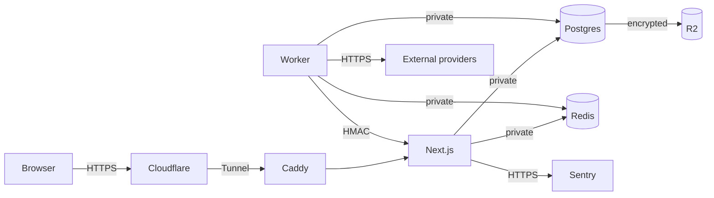

# 09 — Security and Legal

> This document is an engineering risk assessment, not legal advice. Indonesian counsel should review the privacy policy, terms, PSE registration, and data-source licences before public launch.

---

## 1. Assets and threat model

### 1.1 Assets

| Asset | Why it matters |
|---|---|
| User accounts and sessions | Account takeover, impersonation, privacy |
| User lists, ratings, reviews | Private preferences, community trust |
| Admin access | Full control over content, users, providers |
| Database | Source of truth; corruption or leak is severe |
| Provider credentials | API quotas, terms compliance, cost |
| Backups | Recovery; contain personal data |
| Domain/DNS/Cloudflare | Traffic, TLS, email deliverability |
| Source/licence records | Legal defence, takedown response |

### 1.2 STRIDE summary

| Threat | Example | Controls |
|---|---|---|
| **Spoofing** | Credential stuffing, OAuth impersonation | Rate limits, Turnstile, email verification, 2FA for admins, secure cookies |
| **Tampering** | Modify another user’s list/review | Authorization checks on every mutation, ownership checks, CSRF, audit log |
| **Repudiation** | Deny abusive action | Audit log with actor, IP hash, timestamp; moderation actions immutable |
| **Information disclosure** | Private list leaked, DB exposed | Private network, least privilege, no public DB port, field-level privacy, no PII in logs |
| **Denial of service** | Bot flood, expensive search | Cloudflare WAF, rate limits, query caps, circuit breakers, resource limits |
| **Elevation of privilege** | User becomes admin | Role checks server-side, no client-trusted roles, 2FA, least privilege |
| **SSRF** | Image URL fetches internal metadata | `next/image` `remotePatterns` allowlist; no arbitrary fetch; block private IPs |
| **XSS** | Review contains script | Markdown sanitization, CSP, no raw HTML, React escaping |
| **SQL injection** | Search filter injection | Prisma parameterization, Zod validation, never string-concatenate SQL |
| **CSRF** | Forged list update | SameSite cookies, Better Auth CSRF, origin checks, Server Action protections |
| **Supply chain** | Malicious npm package | Lockfile, `npm audit`, Dependabot, pinned versions, provenance |
| **Insider** | Admin abuses access | Audit log, separation of duties, least privilege, 2FA, no shared accounts |

### 1.3 Trust boundaries

- Browser is untrusted.
- Cloudflare is trusted for transport/WAF but not for authorization.
- Worker is trusted but must validate provider data.
- Admin is powerful but audited.
- External providers are untrusted input.

---

## 2. Security controls

### 2.1 Authentication and sessions

- Better Auth database sessions; `HttpOnly`, `Secure`, `SameSite=Lax`.
- Email OTP/magic link with short expiry (10 minutes), single use, rate-limited.
- OAuth state + PKCE; verify email before linking.
- Session rotation on login, role change, email change, ban.
- Admin 2FA (TOTP) enforced.
- “Logout all devices”.
- No passwords at launch; if added later, Argon2id + breach-list check + reset tokens hashed.

### 2.2 Authorization

- Every Server Action and Route Handler checks:
  1. authenticated user,
  2. role/permission,
  3. resource ownership,
  4. input validity.
- Never trust `userId`, `role`, or `mediaId` from the client without checking.
- Admin routes: server-side role check in layout + each action; not only `proxy.ts`.
- IDOR tests: user A cannot read/update user B’s private list.
- Moderators cannot moderate their own content.

### 2.3 Input validation

- Zod at every boundary: forms, route handlers, worker payloads, provider responses.
- Max lengths: search 80 chars, review 10,000, bio 500, notes 2,000.
- Whitelist enums for status/format/season.
- Reject unknown fields in mutations.
- Normalize Unicode; strip control characters.
- Validate `next` redirect is a local path (`/^\/(?!\/)/`).

### 2.4 Output encoding and XSS

- React escapes by default; never `dangerouslySetInnerHTML` except sanitized review HTML and JSON-LD.
- Markdown → sanitized HTML with `rehype-sanitize`; allowlist tags/attributes.
- JSON-LD: `JSON.stringify(...).replace(/</g, "\\u003c")`.
- CSP: `default-src 'self'`; `img-src` allowlist; `script-src` with nonce/hash; no `unsafe-eval`; `object-src 'none'`; `frame-ancestors 'none'`.
- Set `X-Content-Type-Options: nosniff`, `Referrer-Policy: strict-origin-when-cross-origin`, `Permissions-Policy`.
- HSTS after HTTPS is stable.

### 2.5 Database and secrets

- Postgres/Redis bind private interfaces only.
- Separate DB roles: `app` (DML), `worker` (DML + jobs), `migrator` (DDL), `readonly` (analytics).
- No superuser in app.
- Secrets in Docker secrets/SOPS; never in git or client bundles.
- Rotate: DB password, Redis password, Better Auth secret, OAuth secrets, HMAC, R2 keys, SMTP.
- Backups encrypted with `age`; keys stored offline/password manager.
- Connection limits: web 5, worker 3.

### 2.6 Rate limiting

| Surface | Limit |
|---|---|
| Login/OTP | 5 attempts / 10 min / IP + email |
| Sign-up | 3 / hour / IP |
| Search | 60 / min / IP; 10 / min / session for typeahead |
| Reviews | 3 / day / user |
| Ratings | 20 / day / user |
| Reports | 10 / day / user |
| Contact form | 3 / hour / IP |
| Internal revalidate | 100 / min, HMAC only |
| API search | 120 / min / IP |

Use Redis token buckets; return `429` with `Retry-After`. Cloudflare adds an outer layer.

### 2.7 Internal endpoints

`/api/internal/revalidate`:

- HMAC-SHA256 over `timestamp.body` with `INTERNAL_REVALIDATE_SECRET`.
- Reject timestamp older than 5 minutes.
- Reject non-private IPs (`10/8`, `172.16/12`, `192.168/16`, loopback, tunnel).
- Cap tags per request (e.g., 100).
- Rate limit.
- No GET; POST only.
- Return generic errors; log details server-side.

### 2.8 Image handling

- `next/image` `remotePatterns` allowlist: ODbL/MAL CDN, licensed CDN, platform logos.
- No user-supplied image URLs in reviews at launch.
- Do not fetch arbitrary URLs server-side (SSRF).
- Set `maximumRedirects` low; validate content type/size.
- Prefer hotlinking with attribution; rehost only with licence.
- Fallback placeholder if the image fails.

### 2.9 Dependencies and containers

- Pin Prisma, Better Auth, Next, React, Tailwind.
- Dependabot weekly; `npm audit` in CI; fail on high/critical.
- `npm ci` only; lockfile committed.
- Docker: non-root user, read-only root filesystem where possible, no privileged, drop capabilities, minimal base (node:alpine or distroless).
- Scan images with Trivy in CI.
- Do not run untrusted code in the worker.

### 2.10 Admin security

- 2FA mandatory.
- Separate admin session lifetime (shorter).
- IP allowlist optional via Cloudflare Access.
- Audit every mutation with before/after.
- No impersonation at launch.
- Emergency access: two admin accounts, break-glass procedure.

### 2.11 Logging and privacy

- No emails, tokens, cookies, raw IPs, or full request bodies in logs.
- Hash IPs for abuse signals; retain ≤ 30 days.
- Sentry `beforeSend` scrubs PII.
- Access to logs limited to admins.
- Log retention: 30 days app, 90 days worker.

---

## 3. OWASP ASVS checklist (target Level 1/2)

- [ ] V1 Architecture: threat model documented, trust boundaries defined.
- [ ] V2 Authentication: OTP expiry, rate limits, session rotation, no weak recovery.
- [ ] V3 Session: HttpOnly/Secure/SameSite, logout invalidation, idle/absolute timeout.
- [ ] V4 Access Control: deny by default, server-side checks, IDOR tests.
- [ ] V5 Validation: Zod, length limits, allowlists, encoding.
- [ ] V6 Cryptography: TLS 1.2+, Argon2id if passwords, no custom crypto.
- [ ] V7 Errors: no stack traces to users, generic auth errors.
- [ ] V8 Data Protection: minimize PII, encrypt backups, retention.
- [ ] V9 Communications: HTTPS, HSTS, secure cookies.
- [ ] V10 Malicious Code: sanitization, CSP, no raw HTML.
- [ ] V11 Business Logic: anti-abuse, rate limits, idempotency.
- [ ] V12 Files: no user uploads at launch; image allowlist.
- [ ] V13 API: auth, validation, rate limits, HMAC internal.
- [ ] V14 Config: secrets, headers, debug off, default deny.

---

## 4. Data protection (UU PDP)

### 4.1 Scope

Nimelist processes personal data: email, name/username, avatar, IP/user agent (security), list entries, ratings, reviews, follows, and later payment data. The site targets Indonesian users; UU PDP applies.

### 4.2 Principles

| Principle | Implementation |
|---|---|
| Lawful basis | Consent for account/UGC; legitimate interest for security; contract for premium later |
| Purpose limitation | List the purposes; do not repurpose for ads without consent |
| Minimisation | Only collect what is needed; no phone number at launch |
| Accuracy | Profile editing; correction requests |
| Storage limitation | Retention schedule in `04-database.md` |
| Security | Controls in this document |
| Accountability | DPO/contact, records of processing, breach log |
| Transparency | Privacy policy in Indonesian, plain language |

### 4.3 Data subject rights

- Access/portability: JSON export.
- Correction: profile/settings.
- Deletion: 30-day grace, then hard delete/anonymize.
- Objection/restriction: contact/DPO; stop marketing.
- Withdraw consent: delete account or disable optional processing.
- Response within statutory deadline (verify; commonly 3×24 hours for certain requests, 30 days for others). Track requests in a log.

### 4.4 Breach notification

- Detect, contain, assess.
- Notify affected users and the supervisory authority within **3×24 hours** if the breach meets the threshold.
- Record: date, nature, data categories, likely consequences, measures, contact.
- Do not notify prematurely without facts; do not delay unlawfully.
- Post-mortem and control improvements.

### 4.5 DPO and records

- Appoint a DPO/contact if processing meets the criteria; at minimum publish a privacy contact.
- Maintain a simple processing register: purpose, data categories, recipients, retention, transfers, security.
- Train the team annually; log incidents.

### 4.6 Cross-border transfer

Processors may store data outside Indonesia (Cloudflare, Sentry, R2, email, GitHub). Ensure:

- Adequacy or appropriate safeguards as required by UU PDP.
- Processor agreements/DPAs.
- Disclose transfers in the privacy policy.
- Prefer regions near Indonesia (Singapore) where configurable.

### 4.7 Cookies and analytics

- Essential cookies: session, CSRF, theme, timezone — no consent needed.
- Analytics/ads: consent banner with accept/reject, granular categories.
- No non-essential cookies before consent.
- Consent log with version/timestamp.
- Google Consent Mode v2 if GA4/AdSense.
- Privacy-friendly analytics (Plausible/Umami) reduces complexity; still disclose.

### 4.8 Children

- Minimum age 13 with parental consent notice, or 17 for UGC; decide with counsel.
- No targeted ads to minors; no public profile by default.
- Age gate for adult content.
- Report/remove child-safety issues immediately.

---

## 5. Indonesian regulatory checklist

| Item | Why | Action | Owner |
|---|---|---|---|
| **PSE registration** | Private-scope electronic system operators serving Indonesia must register (PP 71/2019, Permenkominfo 5/2020) | Register via OSS/Komdigi; keep certificate | Legal/Admin |
| **UU ITE compliance** | Content takedown, child protection, platform responsibility (Law 11/2008 as amended, incl. Law 1/2024) | Publish guidelines; monitor reports; respond within statutory windows | Legal/Mod |
| **UU PDP** | Privacy, breach notice, DPO, transfers | Privacy policy, consent, retention, breach runbook | Legal/Eng |
| **Terms of Service** | Contract, acceptable use, termination | Publish in Indonesian | Legal |
| **Copyright/takedown** | Posters, synopses, user content | Policy + process + repeat-infringer rule | Legal/Admin |
| **Consumer protection** | Premium later | Clear pricing, refunds, cancellation | Legal/Product |
| **Tax/business** | Ads/premium revenue | Entity, NPWP, VAT/PPh advice | Finance |
| **Domain/brand** | Trademark | Search and register brand/domain | Founder |

**Do not launch UGC before PSE registration and the moderation policy are in place.** If registration is pending, launch the information-only MVP (no reviews) first.

---

## 6. API and data-source terms

### 6.1 AniList

Verified 9 Nov 2026 at <https://docs.anilist.co/guide/terms-of-use> and <https://docs.anilist.co/guide/rate-limiting>.

| Rule | Implication |
|---|---|
| Free for non-commercial use; commercial use has a revenue threshold (currently stated as $150/month) and a licence above it | Ads/affiliate revenue counts as commercial; monitor threshold |
| Using the API as a backup or data storage service is prohibited | Our “store everything in Postgres” model needs written permission |
| Hoarding/mass collection is prohibited | No bulk mirror; request only what the catalog needs |
| Use in competing anime list/tracker services is prohibited | Nimelist is a tracker; needs explicit authorisation |
| Naming guidelines | If “AniList” is in the name, mark “UNOFFICIAL”/“for AniList”; do not use the name alone |
| Rate limit 90/min normal, **30/min during degraded state**; burst limiter; no raises currently | Budget 20/min, concurrency 1 |
| API may be suspended or return 403 | Circuit breaker, graceful degradation |

**Action:** written permission before ingestion. If denied, use ODbL + manual curation and do not store AniList data. If granted, document scope, attribution, retention, and kill switch.

### 6.2 Kitsu

Verified at <https://kitsu.io/terms> and <https://kitsu.docs.apiary.io/>.

| Rule | Implication |
|---|---|
| No commercial use of Kitsu content separate from Kitsu services | A commercial Nimelist database is risky |
| API use subject to separate terms available on request | Request terms before use |
| Public GET endpoints; OAuth for user data | Import only with user consent |
| No published hard rate limit | Still rate-limit politely (5 req/s) |

**Action:** do not use Kitsu as a primary commercial source until written terms confirm it. Use it only for user-authorised import if permitted.

### 6.3 anime-offline-database

Verified at <https://github.com/manami-project/anime-offline-database> and <https://opendatacommons.org/licenses/odbl/1-0/>.

| Rule | Implication |
|---|---|
| ODbL-1.0 + DbCL | Commercial use allowed with attribution and share-alike |
| Attribution | Credit the database and contributors; link to the licence |
| Share-alike | If we publicly use a derivative database, offer it under ODbL; keep user data separate |
| Keep notices | Do not strip copyright/licence notices |
| Database vs contents | ODbL covers the database, not the images/text; poster and synopsis rights remain with owners |
| Archived 4 Jul 2026, ~41,537 entries | No updates; plan manual/provider updates |
| Poster URLs point at MAL CDN | Hotlinking/usage is not licensed by ODbL; legal risk |

**Action:** publish an attribution page and ODbL notice; isolate the derived catalog database from user data; legal review of share-alike scope; have a takedown process for images.

### 6.4 MyAnimeList

- Use the official API v2 for user-authorised import/sync only.
- Do not scrape the website.
- Respect OAuth scopes, rate limits, and user consent.
- Store only what the import needs; allow disconnect/delete.

### 6.5 TMDB / JustWatch / other streaming data

- Do not assume that “public” means “licensed for commercial reuse”.
- Verify terms, attribution, caching limits, and watch-provider data licensing before use.
- At launch, curate streaming links manually from official platform pages.

---

## 7. Image and text copyright

### 7.1 Posters, banners, logos

| Risk | Mitigation |
|---|---|
| Posters are owned by studios/licensors, not by the database | Use only with permission, or hotlink to an authorised source with attribution and a takedown process |
| ODbL does not license images | Do not treat the database licence as an image licence |
| Rehosting is not the same as linking | Avoid downloading/re-encoding unless licensed |
| Platform logos are trademarks | Use according to brand guidelines; no implied endorsement |
| AI-generated fake posters | Do not create or publish them |
| Removing watermarks | Never |

**Launch policy:** use the smallest necessary poster image, hotlink where allowed, attribute the source, provide a takedown form, and replace with a neutral placeholder on request. Seek written permission before scaling commercially.

### 7.2 Synopses and translations

- AniList/MAL/Kitsu synopses are copyrighted text. Translating them is a derivative work.
- **Do not publish machine translations of provider synopses.**
- Write original Indonesian summaries from facts (premise, setting, staff) in our own words.
- If quoting, keep it short, attribute, and link to the source.
- Require contributors to grant Nimelist a licence to their text; state it in the guidelines.
- AI-assisted drafts must be edited and fact-checked; disclose the process in the editorial policy.
- Remove content on a valid takedown request.

### 7.3 Titles and trademarks

- Anime titles are used nominatively to identify the work; that is generally acceptable.
- Do not use logos in a way that implies affiliation.
- Add a disclaimer: “Nimelist tidak berafiliasi dengan studio, penerbit, atau platform streaming.”
- Do not register a confusingly similar domain/brand.

---

## 8. Monetization compliance

### 8.1 Ads (later)

- AdSense/other networks require a privacy policy, cookie consent, ads.txt, and content compliance.
- Anime fan sites with third-party images may face approval friction; do not rely on ad revenue for the MVP.
- No ads on auth, settings, error, or legal pages.
- No interstitials, pop-ups, auto-play video, or ads disguised as download/play buttons.
- Reserve ad height to protect CLS; lazy-load below the fold.
- Monitor INP; remove any ad slot that hurts Core Web Vitals.

### 8.2 Affiliate links

- Disclose: “Tautan afiliasi. Nimelist dapat menerima komisi.”
- Only legal platforms.
- `rel="sponsored nofollow"`.
- Do not let commission influence ranking; label sponsored placements if any.
- Track outbound clicks without personal data.

### 8.3 Premium (later)

- Clear price in IDR, billing period, cancellation, refund policy.
- Payment processor (Midtrans/Xendit) handles card data; Nimelist stores only subscription status and provider IDs.
- Entitlements checked server-side.
- Grace period and dunning emails.
- Tax invoices where required.

---

## 9. Legal pages inventory

| Page | Must include |
|---|---|
| Privacy Policy | Data categories, purposes, legal basis, retention, rights, processors, transfers, breach notice, contact/DPO, children, cookies |
| Terms of Service | Eligibility, account, acceptable use, UGC licence, IP, termination, disclaimers, liability, governing law (Indonesia) |
| Community Guidelines | Review rules, spoilers, harassment, piracy, AI disclosure, enforcement, appeals |
| Copyright Policy | Takedown notice requirements, counter-notice, repeat infringer, response time |
| Cookie Policy | Categories, consent, how to withdraw |
| Disclaimer | No streaming, no affiliation, data accuracy, external links |
| About/Editorial Policy | Who we are, how we curate, sources, corrections |
| Contact/DPO | Real channel, response time |
| Security | How to report a vulnerability (optional) |

All in Indonesian, with an English version only if the audience requires it.

---

## 10. Incident response

### 10.1 Severity

| Sev | Example | Response |
|---|---|---|
| S1 | Data breach, admin compromise, site down | Immediate; notify lead; legal/privacy assessment |
| S2 | Provider blocked, payments failing, widespread errors | 1 hour |
| S3 | Single feature broken, spam wave | Same day |
| S4 | Cosmetic, minor bug | Next sprint |

### 10.2 Runbook

1. **Detect:** Sentry, uptime, user report, provider alert.
2. **Contain:** disable provider/user, rotate secrets, block IP, take feature flag off.
3. **Assess:** scope, data categories, users affected, legal notification trigger.
4. **Eradicate:** patch, revoke sessions, remove content.
5. **Recover:** restore backup, redeploy, verify.
6. **Notify:** users/authority within statutory deadlines if required.
7. **Learn:** blameless post-mortem, action items with owners/dates.
8. **Record:** incident log, evidence, decisions.

### 10.3 Contacts

- Incident lead: [name/role]
- Privacy/DPO: [name/contact]
- Hosting/provider support: [link]
- Legal counsel: [name/contact]
- Registrar/Cloudflare: [account]

Fill these before launch; do not leave placeholders.

---

## 11. Launch legal gate

Do not publicly launch until all are true:

- [ ] Written AniList permission obtained **or** AniList provider disabled and no AniList data stored.
- [ ] ODbL attribution page + licence notice published.
- [ ] Image usage policy and takedown process live.
- [ ] Every published synopsis is original/edited, not a machine translation.
- [ ] Privacy Policy, Terms, Guidelines, Copyright, Cookie Policy live in Indonesian.
- [ ] PSE registration submitted/confirmed (or UGC disabled until it is).
- [ ] Data breach runbook and contact assigned.
- [ ] Consent banner + analytics configured.
- [ ] Admin 2FA, audit log, role checks verified.
- [ ] Backups encrypted; restore test passed.
- [ ] Security headers/CSP verified; dependency scan clean.
- [ ] No pirate links, embeds, or “sub indo” claims.
- [ ] Affiliate disclosure ready (if links exist).
- [ ] Age policy and adult-content gate configured.
- [ ] Domain/brand search done; no confusing similarity.
- [ ] Legal counsel sign-off recorded.
