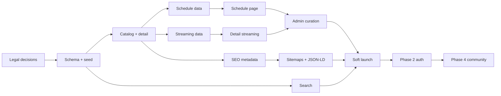

# 10 — Roadmap

## 1. Assumptions

| Assumption | Value |
|---|---|
| Team | 2–3 people: 1 full-stack/backend, 1 frontend/design, 1 part-time curator/editor |
| Capacity | ~2.5 FTE, 5 days/week |
| Launch shape | 4–6 week **schedule MVP** (no accounts at public launch) |
| Hosting | 2 GB / 10 GB laptop for private beta; VPS before public launch |
| Data | ODbL seed + manual curation; AniList disabled until written permission |
| Language | Indonesian only |
| Monetization | None at launch |
| Search | Postgres FTS; Meilisearch later |

**Reality check:** the full product (catalog + accounts + watchlist + reviews + moderation + premium) is ~80–110 person-days. The 4–6 week schedule MVP is ~35–45 person-days. The difference is deliberate: launch the information product, then add accounts.

### Phase mapping note

The original brief puts “auth + watchlist + schedule” in Phase 2. Because the chosen MVP **is the schedule**, the schedule moves into Phase 1. Phase 2 becomes auth + watchlist + ratings after the information MVP. This is the only phase-order deviation, and it is necessary to hit the 4–6 week launch.

---

## 2. Phase 0 — Setup and legal (Week 1)

**Goal:** a deployable skeleton, a legal decision on data sources, and a seeded database.

### 2.1 Legal and product decisions

- [ ] Send AniList permission request (template in `05-data-sync.md`) — **0.5 d** — owner: founder
- [ ] Record AniList response/timeline; decide fallback if no response by Week 2 — **0.5 d**
- [ ] Legal review of ODbL attribution/share-alike — **0.5 d** — owner: founder + counsel
- [ ] Decide image policy (hotlink + attribution + takedown vs licensed assets) — **0.5 d**
- [ ] Confirm domain, brand, and `NEXT_PUBLIC_SITE_URL` — **0.25 d**
- [ ] Confirm PSE registration path; decide whether UGC is deferred — **0.5 d**
- [ ] Confirm minimum age (13+ with safeguards vs 17+) — **0.25 d**

**Dependency:** legal review can run in parallel with engineering, but the image policy blocks the detail page design.

### 2.2 Repository and tooling

- [ ] Convert to npm workspaces (`apps/web`, `apps/worker`, `packages/*`) — **1 d**
- [ ] Add `packages/config` with shared tsconfig/eslint — **0.5 d**
- [ ] Add Zod env validation (`env.ts`) for web and worker — **0.5 d**
- [ ] Add Prettier + import sorting + lint-staged (optional, low cost) — **0.25 d**
- [ ] Add Vitest + Testing Library; one smoke test — **0.5 d**
- [ ] Add Playwright for one critical flow (home → detail) — **0.5 d**
- [ ] Add GitHub Actions: install, lint, typecheck, test, build — **1 d**
- [ ] Add Dockerfiles for web (standalone) and worker — **1 d**
- [ ] Add `compose.lean.yml` with Caddy, web, Postgres, Redis, worker, scheduler — **1 d**
- [ ] Add Cloudflare Tunnel config — **0.5 d**
- [ ] Add `.env.example` and secret generation script — **0.25 d**

### 2.3 Database and seed

- [ ] Pin Prisma `7.10.1`; init `packages/db` — **0.25 d**
- [ ] Create initial schema: media, external_id, genre, studio, streaming, schedule — **2 d**
- [ ] Add extensions (`citext`, `pg_trgm`, `unaccent`) and raw SQL indexes — **0.5 d**
- [ ] Download ODbL dump; write streaming parser + batch upsert — **2 d**
- [ ] Seed 41k media; measure time and DB size — **1 d**
- [ ] Data-quality report: titles, missing seasons, duplicate external IDs — **0.5 d**

### 2.4 Design and shell

- [ ] Install and configure shadcn/ui with Tailwind v4 — **0.5 d**
- [ ] Design tokens: colors, typography (Plus Jakarta Sans), spacing — **1 d**
- [ ] App shell: header, mobile bottom nav, footer, theme toggle — **1.5 d**
- [ ] Home page skeleton with current season + today schedule placeholders — **1 d**
- [ ] 404/error/loading states — **0.5 d**

### Phase 0 exit criteria

- [ ] `docker compose up` serves a Next page on the laptop.
- [ ] CI is green on `main`.
- [ ] Postgres contains ≥ 40k media rows; seed is idempotent.
- [ ] AniList request is sent; decision date recorded.
- [ ] A backup has been taken and restored once.

**Phase 0 estimate:** 18–22 person-days.

---

## 3. Phase 1 — Catalog, search, schedule, streaming, SEO (Weeks 2–3)

**Goal:** a public information MVP: browse, search, detail, season, WIB schedule, legal streaming, admin curation, SEO basics.

### 3.1 Catalog

- [ ] Media list query with filters/sort/pagination — **1.5 d**
- [ ] Catalog page (mobile grid, desktop grid, filter sheet) — **2 d**
- [ ] Anime detail page: poster, titles, meta, synopsis, genres, studio — **2 d**
- [ ] Season page + previous/next navigation — **1 d**
- [ ] Genre landing pages — **0.5 d**
- [ ] Studio landing pages (only studios with ≥ 3 media) — **0.5 d**
- [ ] Related anime (same season/studio/genre) — **1 d**
- [ ] Slug generation, collision handling, slug history — **1 d**
- [ ] `not-found` + `permanentRedirect` for old slugs — **0.5 d**

### 3.2 Search

- [ ] `search_text` builder + generated `search_vector` — **0.5 d**
- [ ] FTS query + trigram fallback — **1 d**
- [ ] Search page + API route — **1 d**
- [ ] Typeahead dialog with keyboard support — **1 d**
- [ ] Synonyms seed for top 100 titles — **0.5 d**
- [ ] Golden-query test suite — **0.5 d**

### 3.3 Schedule (the differentiator)

- [ ] Schedule schema + WIB denormalisation — **0.5 d**
- [ ] Manual schedule CRUD in admin — **1.5 d**
- [ ] `schedule:materialize` job from recurring slot — **1 d**
- [ ] 7-day schedule page, today, date pages — **2 d**
- [ ] Timezone toggle (WIB/WITA/WIT) — **0.5 d**
- [ ] Countdown component (hydrate-safe) — **0.5 d**
- [ ] Confidence labels + “Jadwal dapat berubah” — **0.25 d**
- [ ] Curate first 2 weeks of the current season — **2 d** — owner: curator

### 3.4 Streaming

- [ ] Platform seed data (legal platforms in Indonesia) — **0.5 d**
- [ ] Streaming link CRUD + last-verified + source URL — **1 d**
- [ ] Detail streaming section + platform badges — **1 d**
- [ ] Platform landing pages — **0.5 d**
- [ ] “Laporkan tautan rusak” form + queue — **0.5 d**
- [ ] Curate streaming links for Tier A titles — **2 d** — owner: curator

### 3.5 Admin

- [ ] Admin auth (single admin, 2FA later; use a temporary magic link) — **1 d**
- [ ] Admin dashboard: counts, missing data, stale links — **1 d**
- [ ] Media editor: titles, synopsis, genres, studios, curated fields — **2 d**
- [ ] Audit log for edits — **0.5 d**
- [ ] Import/seed status page — **0.5 d**

### 3.6 SEO and content

- [ ] `metadataBase`, title templates, descriptions — **1 d**
- [ ] Canonical, robots, `noindex` rules — **0.5 d**
- [ ] JSON-LD for detail, breadcrumbs, website — **1 d**
- [ ] Sitemap index + media/season/taxonomy sitemaps — **1.5 d**
- [ ] Open Graph images (static fallback first) — **0.5 d**
- [ ] Indonesian synopsis for Tier A (AI draft + human edit) — **3–5 d** — owner: curator + editor
- [ ] Editorial policy + about page — **0.5 d**

### Phase 1 exit criteria

- [ ] A user can browse, search, open a detail, see legal streaming, and view today’s WIB schedule.
- [ ] Current season has ≥ 40 titles with schedule rows.
- [ ] Tier A has ≥ 100 reviewed Indonesian synopses.
- [ ] Sitemap index validates; thin pages are `noindex`.
- [ ] Lighthouse mobile: LCP < 2.5 s, CLS < 0.1 on the detail page.
- [ ] Admin can fix a schedule time without SQL.

**Phase 1 estimate:** 30–36 person-days.

---

## 4. Phase 2 — Auth, watchlist, ratings, profile (Weeks 4–5, can start post-launch)

**Goal:** retention features. If the 6-week launch gate is tight, launch Phase 1 + Phase 3 first and ship Phase 2 immediately after.

### 4.1 Auth

- [ ] Better Auth + Prisma adapter + schema migration — **1.5 d**
- [ ] Google OAuth app + flow — **0.5 d**
- [ ] Discord OAuth app + flow — **0.5 d**
- [ ] Email OTP/magic link + transactional email — **1 d**
- [ ] Onboarding: username, display name, timezone — **1 d**
- [ ] Session handling in Cache Components (`Suspense`, private cache) — **1 d**
- [ ] Turnstile + Redis rate limits — **0.5 d**
- [ ] Account settings, privacy, deletion, export — **2 d**

### 4.2 Watchlist

- [ ] `list_entry` CRUD + Server Actions — **1.5 d**
- [ ] Add-to-list button/menu on detail — **1 d**
- [ ] Watchlist page with tabs and progress stepper — **2 d**
- [ ] Optimistic updates + error rollback — **0.5 d**
- [ ] Continue-watching rail on home — **1 d**
- [ ] Notes + score — **0.5 d**

### 4.3 Ratings

- [ ] Rating action + aggregate job — **1 d**
- [ ] Bayesian score + minimum count — **0.5 d**
- [ ] Rating UI on detail — **0.5 d**
- [ ] Anti-brigading rate limits — **0.5 d**

### 4.4 Profile

- [ ] Public profile page + privacy rules — **1.5 d**
- [ ] Public list view — **1 d**
- [ ] Stats (episodes, mean score, genres) — **1 d**
- [ ] `noindex` for private profiles — **0.25 d**

### Phase 2 exit criteria

- [ ] A user can sign in with Google/Discord/email, add a title, update progress, rate it, and see it on their profile.
- [ ] Private data is not visible to other users or search engines.
- [ ] Account deletion removes/anonymizes data correctly.
- [ ] No session data is cached publicly.

**Phase 2 estimate:** 18–22 person-days.

---

## 5. Phase 3 — SEO, monitoring, soft launch (Week 6)

**Goal:** public beta on a stable host, measurable, backed up, legally covered.

### 5.1 SEO hardening

- [ ] Search Console + Bing verification — **0.25 d**
- [ ] Sitemap submission; index coverage review — **0.5 d**
- [ ] Rich Results Test for detail/season/breadcrumb — **0.5 d**
- [ ] Internal linking audit — **0.5 d**
- [ ] Thin-content audit: `noindex` anything without a reviewed synopsis — **0.5 d**
- [ ] Canonical/redirect audit (www, trailing slash, old slugs) — **0.5 d**
- [ ] Indonesian copy review of top 50 pages — **1 d**

### 5.2 Performance

- [ ] Lighthouse CI on home/detail/schedule — **0.5 d**
- [ ] Image audit: sizes, formats, priority, LCP — **0.5 d**
- [ ] Font subsetting/preload — **0.25 d**
- [ ] Remove unnecessary client components — **0.5 d**
- [ ] Cloudflare cache rules for static assets — **0.25 d**

### 5.3 Ops

- [ ] Sentry web + worker — **0.5 d**
- [ ] External uptime monitor + job heartbeats — **0.5 d**
- [ ] Backup job to R2 + encryption — **0.5 d**
- [ ] Restore test on a clean database — **0.5 d**
- [ ] Disk/memory alerts — **0.25 d**
- [ ] Log rotation + Docker prune cron — **0.25 d**
- [ ] Health endpoint + smoke test script — **0.5 d**
- [ ] Incident contacts + runbook — **0.5 d**

### 5.4 Legal

- [ ] Privacy Policy, Terms, Guidelines, Copyright, Cookie Policy — **1.5 d** — owner: legal/founder
- [ ] ODbL attribution page — **0.25 d**
- [ ] Image attribution/takedown form — **0.5 d**
- [ ] PSE registration status — **0.5 d**
- [ ] Consent banner + analytics config — **0.5 d**
- [ ] Age gate for adult content — **0.25 d**

### 5.5 Launch gate

- [ ] Move to a 4 GB VPS **or** explicitly accept private-beta-only reliability — **0.5 d**
- [ ] Cloudflare DNS/Tunnel cutover — **0.5 d**
- [ ] Final smoke test on production — **0.5 d**
- [ ] Invite 20–50 beta users; collect feedback — **1 d**
- [ ] Monitor for 72 hours; fix only launch blockers — **1 d**

### Phase 3 exit criteria

- [ ] Production is HTTPS, monitored, backed up, and restores.
- [ ] Search Console shows the sitemap; 0 accidental `noindex` on Tier A.
- [ ] Core Web Vitals pass on mobile.
- [ ] Legal pages are live.
- [ ] No AniList data is stored.
- [ ] A rollback has been tested.

**Phase 3 estimate:** 10–12 person-days.

---

## 6. Phase 4 — Community, sync, premium (post-launch, 4–8 weeks)

**Goal:** retention and monetization after the catalog is trusted.

### 6.1 Reviews and moderation

- [ ] Review schema + Markdown editor + sanitization — **2 d**
- [ ] Review detail/list pages + SEO — **1.5 d**
- [ ] Spoiler gate + helpful votes — **1 d**
- [ ] Report flow + moderation queue — **2 d**
- [ ] Roles, audit log, suspensions, appeals — **1.5 d**
- [ ] Community guidelines + enforcement — **1 d**
- [ ] Spam controls (Turnstile, rate limits, SimHash) — **1.5 d**

### 6.2 Social

- [ ] Follow + follower lists — **1 d**
- [ ] Activity feed (optional) — **1.5 d**
- [ ] Notifications (email/in-app) — **2 d**
- [ ] Blocking/muting — **1 d**

### 6.3 Import/sync

- [ ] MAL OAuth import + mapping + preview — **3 d**
- [ ] AniList OAuth import/sync **only after permission** — **4 d**
- [ ] Conflict resolution + progress UI — **1.5 d**
- [ ] Disconnect/delete tokens — **0.5 d**

### 6.4 Search upgrade

- [ ] Meilisearch deployment on VPS — **1 d**
- [ ] Index settings + document serializer — **1 d**
- [ ] Incremental + full reindex — **1 d**
- [ ] Fallback + relevance tests — **1 d**

### 6.5 Monetization

- [ ] Affiliate links + disclosure + click tracking — **1 d**
- [ ] Ads decision; AdSense/alternative test — **1 d**
- [ ] Premium entitlements + pricing page — **2 d**
- [ ] Midtrans/Xendit integration + webhooks — **3 d**
- [ ] Refund/cancellation/dunning — **1.5 d**

### Phase 4 estimate

- Reviews/moderation: 10–12 person-days.
- Social/notifications: 5–6 person-days.
- Import/sync: 9–11 person-days.
- Search upgrade: 4 person-days.
- Monetization: 8–10 person-days.
- **Total: 36–43 person-days.**

---

## 7. Critical path

**Critical path:** legal → schema/seed → catalog/detail → schedule data → admin → SEO → launch.

### Dependencies and risks

| Task | Depends on | Risk |
|---|---|---|
| AniList provider | Written permission | Blocks only provider sync, not launch |
| ODbL seed | Legal review of attribution | Blocks catalog |
| Image policy | Legal review | Blocks detail page assets |
| Schedule data | Curator availability | Blocks the differentiator |
| SEO | Stable URL/slug strategy | Rework if slugs change later |
| VPS move | Budget approval | Blocks public launch |
| Auth | Better Auth/Prisma compatibility spike | Blocks Phase 2, not MVP |

---

## 8. Scope cuts if behind

Cut in this order:

1. **Related anime** — nice internal linking, not essential.
2. **Studio landing pages** — keep genre/season/platform.
3. **Timezone toggle WITA/WIT** — ship WIB only; add later.
4. **Countdown** — replace with static time.
5. **Typeahead** — ship a search page first; add suggestions later.
6. **Dynamic OG images** — static fallback.
7. **Character/staff data** — already out of MVP.
8. **Dark mode** — keep system default; defer manual toggle.
9. **Admin dashboard charts** — use counts/tables.
10. **Reviews** — already post-MVP.

Do **not** cut:

- Legal pages and AniList kill switch.
- Backups/restore.
- `noindex` for thin pages.
- Schedule accuracy labels.
- Mobile performance.
- Moderation queue if UGC exists.

---

## 9. Launch checklist

### Product

- [ ] Home, catalog, detail, season, schedule, platform pages work on mobile.
- [ ] Current season has schedule + streaming for ≥ 40 titles.
- [ ] Tier A has reviewed Indonesian synopses.
- [ ] Search returns useful results for romaji/English/Indonesian.
- [ ] Empty/error/loading states exist.
- [ ] No dead links in navigation/footer.
- [ ] Legal disclaimer visible.

### SEO

- [ ] Unique title/description/canonical on indexable pages.
- [ ] Sitemap index + child sitemaps valid.
- [ ] JSON-LD validates.
- [ ] `noindex` on admin/auth/search/filtered/thin/adult.
- [ ] Search Console/Bing verified.
- [ ] Open Graph preview correct.
- [ ] 301 slug history works.

### Performance

- [ ] LCP < 2.5 s p75 mobile.
- [ ] INP < 200 ms.
- [ ] CLS < 0.1.
- [ ] JS bundle within budget.
- [ ] Images sized/compressed.
- [ ] Cloudflare caching verified.

### Security/legal

- [ ] Admin 2FA.
- [ ] Rate limits active.
- [ ] CSP/headers verified.
- [ ] Backups encrypted + restore tested.
- [ ] Privacy/Terms/Guidelines/Copyright live.
- [ ] PSE status confirmed.
- [ ] AniList disabled.
- [ ] ODbL attribution live.
- [ ] Takedown contact live.

### Ops

- [ ] Uptime monitor + alerts.
- [ ] Sentry events have releases.
- [ ] Disk/memory alerts.
- [ ] Rollback tested.
- [ ] Incident contacts filled.
- [ ] On-call expectation agreed.

---

## 10. Weekly cadence

| Day | Ritual |
|---|---|
| Monday | Plan the week; check launch gate; curate new season |
| Wednesday | Data quality review: missing synopsis/schedule/streaming |
| Friday | Deploy to staging; smoke test; review metrics/Sentry |
| Monthly | Restore test; dependency updates; content audit; legal checklist |

**Definition of done for every task:** code + test + mobile check + accessible + analytics/SEO considered + deployed to staging.
